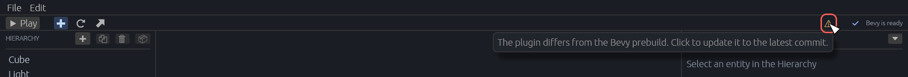
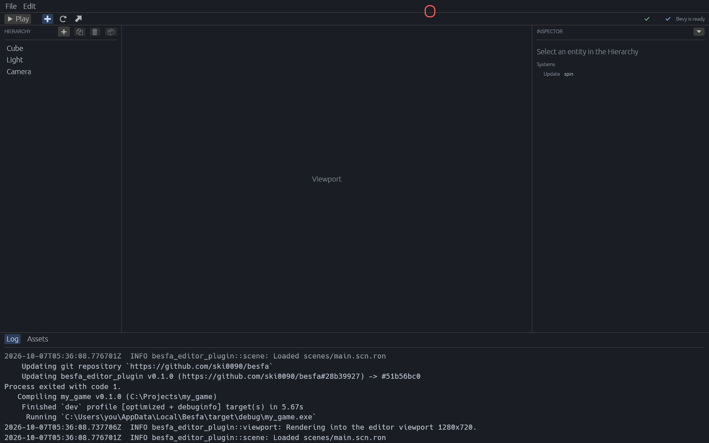

# Besfa

[English](README.md) | **한국어**

Bevy 게임 엔진을 위한 데스크톱 에디터입니다. 에디터 UI는 egui, 프로젝트 관리는 `besfa` CLI가 담당하며, 둘 다 Rust로 작성합니다. 자세한 내용은 [docs/PROJECT_OVERVIEW.md](docs/PROJECT_OVERVIEW.md)를 참고하세요.

## 요구 사항

- Windows
- [Rust](https://rustup.rs/) (`cargo`가 PATH에 있어야 합니다)

## 설치

### 1. CLI 설치

에디터는 PATH에서 `besfa` 실행 파일을 찾습니다.

```bash
cargo install --path crates/besfa_cli
```

`~/.cargo/bin/besfa.exe`가 설치됩니다. 확인:

```bash
besfa --version
```

CLI 코드를 수정했다면 같은 명령을 다시 실행해 갱신하세요.

### 2. 에디터 실행

```bash
cargo run -p besfa_editor
```

CLI를 설치한 뒤에는 에디터를 다시 시작해야 PATH 변경이 반영됩니다.

## 프로젝트 만들기

- 에디터: Project Hub에서 **New project** → 새 폴더 경로 입력 → **Create**
- CLI: `besfa new C:\Projects\my_game`

대상 폴더는 아직 없어야 하며, 폴더 이름이 프로젝트 이름이 됩니다.

`besfa new`는 `.mcp.json`도 만듭니다. 그래서 프로젝트에서 연 Claude Code가 `besfa mcp`로 게임을 띄워, 에디터 없이 씬에 물건을 놓고 땅을 빚고 흩뿌리고 사진을 찍을 수 있습니다. 게임은 창 없이 실행됩니다. 같은 프로젝트를 에디터와 동시에 다루지 마세요. 둘 다 씬 파일을 씁니다. 예전에 만든 프로젝트에는 같은 파일을 넣으면 됩니다.

```json
{ "mcpServers": { "besfa": { "command": "besfa", "args": ["mcp"] } } }
```

설치된 `besfa`는 자신이 모르는 새 명령을 거절하므로, 플러그인을 업데이트하면 CLI도 다시 설치하세요.

## 업데이트

### 에디터와 CLI

```bash
git pull
cargo install --path crates/besfa_cli
```

그다음 에디터를 다시 시작하세요(`cargo run -p besfa_editor`). CLI 재설치는 `crates/besfa_cli`가 바뀌었을 때 필요합니다.

에디터는 시작할 때 백그라운드에서 `besfa prebuild`를 실행합니다. 이 명령은 공유 Bevy 빌드를 GitHub의 최신 `besfa_editor_plugin`으로 올려서 빌드합니다. 진행 상황은 툴바에 나오고, **Bevy is ready**가 뜰 때까지 **Play**는 기다립니다.

### 게임 프로젝트의 플러그인

게임은 `besfa_editor_plugin`을 GitHub에서 받고, `Cargo.lock`이 커밋 하나에 고정합니다. 그래서 업데이트하기 전까지는 그 플러그인을 계속 씁니다. 에디터 툴바 오른쪽의 아이콘이 프로젝트의 커밋과 Bevy 미리 빌드의 커밋을 비교해 보여 줍니다.

- 초록 체크: 같은 커밋입니다.
- 노란 경고: 다른 커밋입니다. 마우스를 올리면 누르면 무엇을 하는지 나옵니다.



아이콘을 누르면 업데이트합니다. 에디터는 프로젝트에서 `cargo update -p besfa_editor_plugin`을 실행하고(다른 의존성은 건드리지 않습니다), 게임을 멈춘 뒤 새 플러그인으로 다시 빌드합니다. cargo의 출력은 **Log** 패널에 나오고(`Process exited with code 1.`은 이전 게임을 멈춘 기록입니다), 아이콘은 초록으로 바뀝니다.



에디터 없이 하려면 프로젝트 폴더에서 같은 명령을 실행하세요.

```bash
cargo update -p besfa_editor_plugin
```

아직 `Cargo.lock`이 없거나 플러그인을 로컬 경로로 쓰는 프로젝트에는 아이콘이 나오지 않습니다.

플러그인 변경은 GitHub의 `main`에 push해야 게임에 반영됩니다. push한 뒤에는 에디터를 다시 시작해 미리 빌드를 새 커밋으로 올리고, 각 프로젝트에서 아이콘을 누르세요.

## 테스트

```bash
cargo test
```

README의 스크린샷은 테스트로 그립니다. UI를 바꾼 뒤에는 다시 찍으세요(`docs/images`에 저장됩니다).

```bash
cargo test -p besfa_editor readme_screenshots -- --ignored
```
