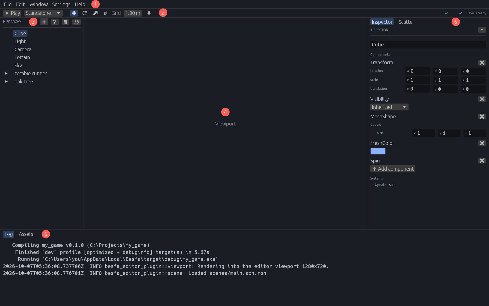

# Besfa

[English](README.md) | **한국어**

> 📖 **[사용 설명서](docs/manual/README.md)**: 설치, 프로젝트 만들기, Agent 창까지 에디터의 모든 부분을 스크린샷과 함께 차근차근 설명합니다.

Besfa는 Windows에서 쓰는 [Bevy](https://bevy.org/) 게임 엔진용 데스크톱 에디터입니다. 내 게임이 에디터 안에서 실행됩니다. 뷰포트로 게임을 보면서, 멈춘 상태로 물건을 놓고 값을 고치고, 실행해 보고, 씬을 파일에 저장합니다. 에디터 UI는 egui로 만들어 영어와 한국어로 볼 수 있고(**Settings > Language**), 프로젝트 관리는 `besfa` CLI가 맡습니다. 둘 다 Rust로 작성합니다.

## 할 수 있는 일

- **프로젝트**: 프로젝트 허브와 `besfa` CLI가 Bevy 게임 프로젝트를 만들고 엽니다. 만들 때 [Claude Code Game Studios](https://github.com/ski0090/Claude-Code-Game-Studios)를 함께 넣을 수 있습니다. Bevy는 한 번 미리 빌드해 함께 쓰므로 게임은 자기 코드만 컴파일하고, `besfa build`, `besfa test`, `besfa run`은 에디터와 같은 feature로 빌드해 그 빌드를 다시 씁니다.
- **에디터 안에서 실행**: 게임은 뷰포트에서 멈춘 편집 상태로 뜨고, Play로 실행하고 Stop으로 돌아옵니다. 코드를 고치면 다시 빌드하고, Hierarchy와 Inspector, 씬 뷰는 보던 그대로 돌아옵니다.
- **씬 편집**: 씬 엔티티의 Hierarchy, Reflect 컴포넌트를 고치는 Inspector, 카메라·이동/회전/크기 핸들·맞춤이 있는 씬 뷰, 되돌리기. 게임의 씬 파일에 저장합니다.
- **에셋**: glTF 모델과 프리팹 놓기, 썸네일, 바뀐 모델 다시 가져오기, 프리팹 저장과 적용, 모델 하나를 클립과 함께 따로 보는 미리보기.
- **월드 만들기**: 지형 빚기와 칠하기, 폴리지, 붓으로 흩뿌리기, 하늘.
- **애니메이션**: 모델의 클립을 묶는 애니메이션 상태 기계.
- **멀티플레이**: 데디케이트 서버와 거기 들어가는 클라이언트로 Play.
- **에이전트 채팅**: 에디터 메뉴 막대의 **Window > Agent Window**를 켜면 Claude, ChatGPT, Gemini와 대화하는 별도 창이 열립니다. 제공자마다 자기 CLI로 연결하거나, Windows 자격 증명 관리자에 넣어 둔 API 키로 연결합니다. 새 채팅을 시작하고, 접고 펼 수 있는 히스토리에서 이전 채팅을 다시 열고, 프롬프트에 파일을 첨부합니다. 창의 Settings 탭에서 Claude가 부를 수 있는 프로젝트의 MCP 서버와, 커밋·푸시·풀 리퀘스트를 맡길지, 조직 실행이 연 풀 리퀘스트를 리뷰하고 머지까지 하고 끝낸 이슈를 닫을지를 고릅니다.
- **에이전트 조직**: Agent 창의 Organization 탭에서 블루프린트처럼 노드를 이어 에이전트 팀을 만듭니다. 에이전트마다 역할(Claude Code Game Studios의 역할을 바로 추가), 모델, 수준(effort)을 정하고, 이어진 에이전트에게 결과를 넘깁니다. 노드는 그룹으로 묶어 관리합니다. 조직은 여러 개를 두고 각각 파일로 저장합니다. Agent 채팅의 모델 목록 아래에서 조직을 골라 작업을 보내면, 에이전트마다 링크 순서대로 채팅에 답하고, 할 일이 남은 에이전트는 새 보고를 받아 다시 돕니다(첫 라운드를 포함해 세 라운드까지). 생각과 도구 호출은 이름 아래에 접혀 있다가 클릭하면 펼쳐집니다. 멈춘 실행은 에디터를 다시 연 뒤에도 이어서 돌릴 수 있습니다. 앞 에이전트가 모두 끝난 에이전트들은 저마다 git 워크트리에서 함께 일하고, 에이전트가 끝나면 에디터가 그 일을 프로젝트에 머지한 뒤 워크트리를 지웁니다.
- **에이전트**: `besfa mcp`로 Claude Code가 에디터 없이 게임을 띄워 씬을 고치고 OpenAI 이미지 API로 PNG를 그리며, `besfa screenshot`으로 플레이어가 보는 화면을 남깁니다.

## 구성

에디터와 게임은 따로 도는 프로세스입니다. 에디터는 게임을 `besfa_editor_plugin`과 함께 띄우고, 게임은 에디터가 보여 주는 텍스처에 그리며 stdin과 stdout으로 에디터와 대화합니다. Hierarchy와 Inspector는 게임이 자기 월드를 바로 읽어 그 텍스처에 직접 그리고, 에디터는 마우스와 키보드를 넘겨 줍니다. 메뉴, 툴바, 로그, 에셋, 에이전트는 에디터가 그립니다. 게임이 다시 시작하면 에디터가 그 패널들과 씬 뷰의 모습을 돌려줍니다. 게임은 이 저장소의 Besfa 크레이트에만 의존하고, 릴리스 빌드에는 에디터 없이 `besfa_components`만 들어갑니다.

| 크레이트 | 역할 |
| --- | --- |
| `besfa_editor` | egui 데스크톱 에디터 |
| `besfa_cli` | `besfa` 명령: 프로젝트 만들기, Bevy 미리 빌드, 게임 빌드·테스트·실행, 스크린샷, MCP 서버 띄우기 |
| `besfa_protocol` | 에디터와 게임 사이의 메시지 |
| `besfa_ui` | 에디터와 게임이 그리는 패널이 함께 쓰는 테마, 번역, 트리 |
| `besfa_editor_plugin` | 에디터가 게임을 띄울 때 넣는 Bevy 플러그인 |
| `besfa_components` | 게임이 릴리스에 담는 컴포넌트: 씬 파일, 지형, 하늘, 애니메이션 상태 기계 |
| `besfa_net` | 데디케이트 서버와 그 연결 |
| `besfa_mcp` | 에이전트용 MCP 서버 |

## 문서

- [사용 설명서](docs/manual/README.md): 에디터 쓰는 법
- [프로젝트 개요](docs/PROJECT_OVERVIEW.md), [아키텍처](docs/ARCHITECTURE.md)와 [docs](docs)의 다른 설계 문서: 만든 방식
