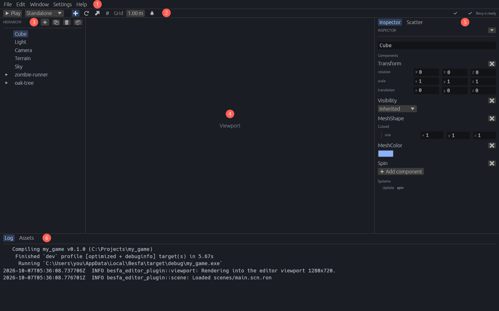

# Besfa

**English** | [한국어](README.ko.md)

> 📖 **[User manual](docs/manual/README.md)** (in Korean): installing, creating a project, and every part of the editor, the Agent window included, step by step with screenshots.

Besfa is a desktop editor for the [Bevy](https://bevy.org/) game engine on Windows. Your game runs inside the editor: you look at it in the viewport, place and change things while it is paused, play it, and save the scene back to a file. The editor UI is built with egui and shows in English or Korean (Settings > Language), project management is the `besfa` CLI, and both are written in Rust.

## What it does

- **Projects**: a project hub and the `besfa` CLI create Bevy game projects and open existing ones, optionally with [Claude Code Game Studios](https://github.com/ski0090/Claude-Code-Game-Studios) added. Bevy is prebuilt once and shared, so a game compiles only its own code; `besfa build`, `besfa test` and `besfa run` build with the editor's features to reuse that build.
- **Run in the editor**: the game runs paused in edit mode in the viewport; Play runs it, Stop goes back. Code changes rebuild it, and the Hierarchy, the Inspector and the scene view come back as they were.
- **Scene editing**: a hierarchy of the scene's entities, an inspector for their reflected components, a scene view with a camera, move/rotate/scale handles and snapping, undo and redo, saved to the game's scene file.
- **Assets**: place glTF models and prefabs, see thumbnails, reimport changed models, save and apply prefabs, preview a model on its own with its clips.
- **World building**: sculpt and paint terrain, grow foliage, scatter props with a brush, set the sky.
- **Animation**: animation state machines over a model's clips.
- **Multiplayer**: play a dedicated server with clients joined to it.
- **Agent chat**: Window > Agent Window in the editor's menu bar opens a chat in its own window with Claude, ChatGPT or Gemini, each reached through its own CLI or an API key kept in the Windows Credential Manager. Start new chats, reopen earlier ones from a collapsible history, and attach files to a prompt. The window's Settings tab picks the project's MCP servers Claude may call and whether it may commit, push and open pull requests, and whether Organization runs review and merge the pull requests they open and close the issues those finish.
- **Agent organization**: the Agent window's Organization tab wires agents into a team like a Blueprint graph. Each agent has a role (Claude Code Game Studios' roles come ready to add), its own model and effort, and hands its result to the agents it links to; nodes can be boxed into groups. A project can keep several organizations, each in its own file. Pick one below the models in the Agent chat to send it a task: each agent answers in the chat in link order, with its thoughts and tool calls folded under its name until clicked, and the agents with work left go again with the new reports, for at most three rounds in all. A run that stopped can be continued, even after the editor restarts.
- **Agents**: `besfa mcp` lets Claude Code run the game without the editor and edit its scene, and draw PNGs with OpenAI's image API, and `besfa screenshot` saves what the player sees.

## How it fits together

The editor and the game are separate processes. The editor starts the game with `besfa_editor_plugin`, which renders into a texture the editor shows and talks to the editor over the game's stdin and stdout. The game draws the Hierarchy and the Inspector into that texture itself, straight from its own world, and the editor passes the mouse and the keyboard on to them; the menus, the toolbar, the log, the assets and the agents are the editor's own. When the game restarts, the editor hands it back how those panels and the scene view looked. Games depend only on Besfa crates from this repository, and a release build ships `besfa_components` without the editor.

| Crate | Role |
| --- | --- |
| `besfa_editor` | The egui desktop editor |
| `besfa_cli` | The `besfa` command: create projects, prebuild Bevy, build, test and run games, take screenshots, run the MCP server |
| `besfa_protocol` | Messages between the editor and the game |
| `besfa_ui` | The theme, languages and tree the editor shares with the panels a game draws |
| `besfa_editor_plugin` | The Bevy plugin the editor runs games with |
| `besfa_components` | Components games ship: scene file, terrain, sky, animation state machines |
| `besfa_net` | Dedicated servers and their connections |
| `besfa_mcp` | The MCP server for agents |

## Documentation

- [User manual](docs/manual/README.md) (Korean): how to use the editor
- [Project overview](docs/PROJECT_OVERVIEW.md), [architecture](docs/ARCHITECTURE.md) and the other design documents in [docs](docs) (Korean): how it is built
