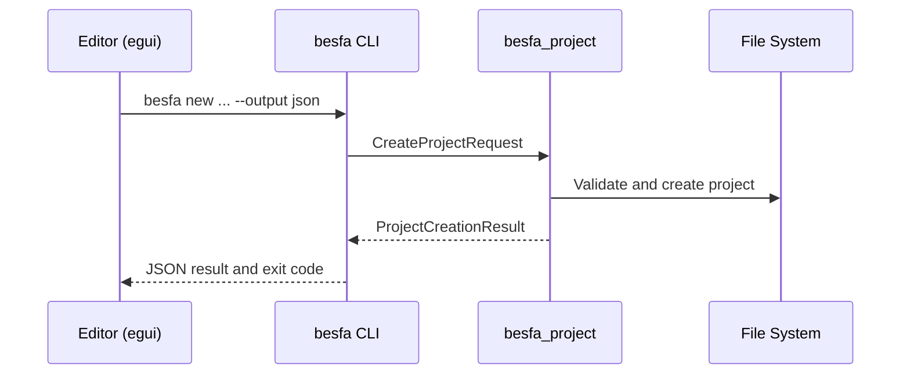
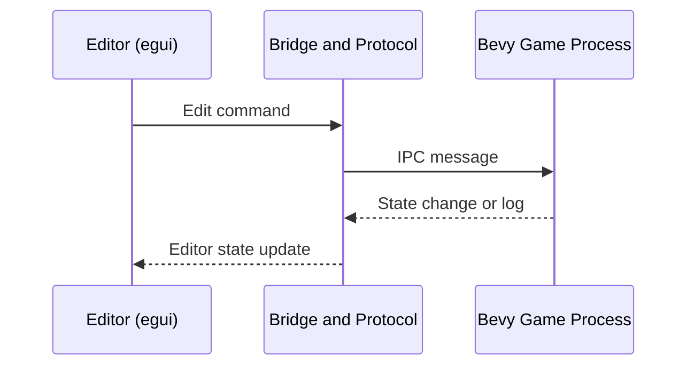
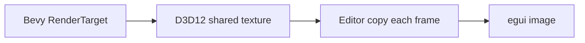

# 아키텍처

Besfa에는 수명과 책임이 다른 두 연결 경로가 있다. 프로젝트 생성 경로와 실행 중 게임 편집 경로를 같은 통신 방식으로 취급하지 않는다.

## 프로젝트 생성

`besfa_cli`는 짧게 실행되고 종료되는 자동화 도구다. 에디터는 CLI를 자식 프로세스로 실행하며, 실제 파일 생성 규칙은 향후 `besfa_project` crate가 담당한다.

CLI는 프로젝트 생성, 검증, 마이그레이션, 빌드 자동화와 CI 용도를 담당한다. 실행 중인 게임 세션이나 뷰포트 렌더링은 담당하지 않는다.

## 실행 중 게임 편집

에디터와 Bevy 게임은 별도 프로세스다. 게임 프로젝트에는 `besfa_editor_plugin`이 포함되고, 에디터는 장기 IPC를 통해 명령을 보내고 상태를 받는다.

메시지 타입은 에디터와 플러그인이 함께 쓰는 `besfa_protocol` crate에 있다(`Request`, `Command`, `Report`). 채널은 게임의 표준 입출력이고, 양쪽 모두 한 줄에 JSON 객체 하나를 쓴다. 게임은 Cargo.lock이 고정한 플러그인 커밋을 계속 쓰므로 에디터는 오래된 플러그인과도 말해야 한다. 그래서 메시지는 상대가 몰라도 되는 필드만 더하고, 플러그인이 아는 것은 프로토콜 버전(`besfa_protocol::VERSION`, 지금 3)으로 센다. 에디터는 게임의 stdin에 `command`로 이름 붙인 명령을 쓴다: 편집 상태에서 실행 상태로 넘기는 `play`, 엔티티를 고르거나(`id`) 선택을 지우는 `select`, 씬 파일을 쓰는 `save`, 컴포넌트 값을 통째로 바꾸는(없으면 붙이는) `set`(`id`, `component`, `value`), 기본값으로 붙이는 `insert`와 떼는 `remove`(`id`, `component`), 씬 엔티티를 만드는 `spawn`(`kind`: `empty`, `cube`, `sphere`, `plane`, `light`, `camera`), `duplicate`(`id`), 에셋 폴더의 glTF 모델이나 씬·프리팹 파일을 보여 주는 엔티티를 만드는 `instantiate`(`path`), 엔티티와 자식을 숨기는 `delete`와 되살리는 `restore`(`id`, 실행 취소를 위해 지우지 않고 비활성화해 둔다), 실행 취소로 되살릴 수 없게 된 숨긴 엔티티를 자식과 함께 없애는 `despawn`(`id`, 숨기지 않은 엔티티는 거절한다), 엔티티와 저장되는 자식을 프리팹 파일로 쓰는 `save_prefab`(`id`, 에셋 폴더 안의 `.scn.ron` `path`), 놓인 씬·프리팹이 지금 보여 주는 엔티티를 그 파일에 다시 쓰고 파일을 다시 읽어 모든 인스턴스에 반영하는 `apply_prefab`(`id`), 편집 상태에서는 씬 뷰의, 실행 상태에서는 게임의 마우스인 `pointer`(`event`: `down`·`move`·`up`과 텍스처 픽셀 좌표 `x`, `y`, 누른 `button`: `left`·`middle`·`right`, 또는 `scroll`과 `delta`), 실행 상태에서 뷰포트가 받은 키를 게임에 넘기는 `key`(`code`: Bevy `KeyCode` 이름이기도 한 W3C 물리 키 이름, `pressed`, 입력한 글자 `text`)와 누르고 있던 키를 모두 놓게 하는 `focus_lost`, 핸들 도구를 고르는 `tool`(`translate`·`rotate`·`scale`), 선택한 엔티티로 다가가는 `focus`, 오른쪽 버튼을 누르고 있는 동안 씬 뷰를 날게 하는 `fly`(`right`, `up`, `forward`: 각각 -1~1, `fast`; 버튼을 놓으면 멈춘다), 크기를 바꾼 뷰포트 텍스처로 옮기는 `viewport`(`name`). 프로토콜 2부터는 모델 미리보기 명령이 있다: 에셋 폴더의 glTF 모델을 씬 뷰 대신 보여 주는 `preview`(`path`, 이미 보이는 모델이 아니면 새로 읽는다. 경로가 없으면 모델을 버리고 씬 뷰로 돌아간다. 편집 상태에서만 받고, `play`도 미리보기를 닫는다), 모델을 보고한 순서의 클립 `clip`의 `time`초 자세로 두고 실제 시간의 `speed`배로 움직이는 `preview_animation`(`looping`이면 돌아가고 아니면 끝에서 멈춘다. `speed`가 0이면 그 자세에 멈춘다. 프로토콜 3부터 `clip`이 없으면 클립을 멈추고 모델을 읽었을 때의 자세로 돌린다), 부품 `hidden`과 그 아래 메시를 숨기고 `solo`가 있으면 그 부품만 보이는 `preview_parts`, 조명을 고르는 `preview_light`(`light`: `studio`·`daylight`·`night`. 게임이 미리보기 카메라에 넣은 노출에 맞춰 밝기를 키운다). 프로토콜 3부터는 정해진 시점에서 모델을 맞춰 보는 `preview_view`(`view`: `front`·`back`·`left`·`right`·`top`·`three_quarter`, 모델의 앞은 Bevy의 -Z다. 이후 `focus`도 이 시점으로 맞춘다)와 미리보기 화면을 프로젝트 안의 PNG `path`에 저장하는 `preview_screenshot`, 모델 위에 덧그릴 것을 고르는 `preview_overlays`(`skeleton`: 관절에서 부모 관절로 잇는 선, `markers`: 표시점의 축, `bounds`: 경계 상자), 미리보기 모델의 부품이나 루트를 골라 그 컴포넌트를 선택한 엔티티처럼 `entity`로 보고하게 하는 `preview_select`(`id`, 씬의 선택은 그대로 둔다. 고른 부품에는 `set`·`insert`·`remove`를 그대로 쓴다), 디스크에서 바뀐 glTF 모델 파일을 다시 읽는 `reimport`(`path`, 편집 상태와 실행 상태 모두에서 받는다), 모델의 썸네일을 그리는 `thumbnail`(`path`, 프로젝트 안의 PNG `file`)이 있다. 게임은 `thumbnail`을 받은 순서대로 한 번에 하나씩, 따로 쓰는 렌더 레이어(30)에서 꺼져 있던 카메라로 모델을 미리보기의 ¾ 시점처럼 맞춰 256×256 이미지에 그린다. 배경은 투명하고, 조명은 Studio 프리셋을 카메라의 노출에 맞춘다. 셰이더 파이프라인이 컴파일되기 전의 메시는 그려지지 않으므로, 렌더러가 몇 프레임 연속 컴파일 중인 파이프라인이 없을 때 찍는다(렌더 월드의 `PipelineCache`에서 센다). `reimport`는 그 파일을 보여 주는 놓인 모델과 미리보기 모델이 없으면 바로 끝난다. 있으면 파일을 다시 읽고, 다 읽은 뒤 몇 프레임 동안 다시 바뀌지 않으면 그 모델들을 모두 새로 펼친다(Bevy의 스포너는 직전 변경 뒤 몇 프레임 안에 온 변경을 버리므로, 그대로 두면 옛 파일의 모습이 남을 수 있다). 모두 새로 펼쳐지면 게임에 각 루트로 `besfa_editor_plugin::Reimported` 엔티티 이벤트를 보내므로, 모델이 펼친 것을 바꾸는 게임(머티리얼 교체 등)은 이 이벤트에서 다시 적용하면 된다. Bevy의 `WorldInstanceReady`도 함께 온다. 미리보기 중에는 `pointer`가 미리보기 카메라를 돌리고 `focus`는 모델에 다시 맞춘다. 클립의 시간은 에디터와 게임이 같은 규칙(`besfa_protocol::clip_time`)으로 각자 움직이므로 보고하지 않는다. 엔티티 `id`는 게임이 보고한 Bevy 엔티티 비트이고, `component`는 Reflect 타입 경로(씬 파일과 같은 이름)다. 값은 게임이 보고한 JSON 모양 그대로이며, 빠진 필드는 그 타입의 기본값이 된다. 놓인 glTF 모델의 부품에 한 `set`·`insert`·`remove`는 게임이 그 루트의 `PartChanges`에 부품 이름 경로로 기록해 씬과 함께 저장하고 모델이 펼쳐질 때마다 다시 건다. 루트의 `PartChanges`를 `set`하면 바로 다시 걸고, `remove`하면 모델을 파일 그대로 다시 펼친다. 경로가 있는 에셋 핸들은 씬 파일처럼 `{"Path": "..."}`로 주고받는다. 게임은 stdout에 `@besfa ` 접두어와 JSON 객체 한 줄로 보고하고, 에디터는 이 접두어로 보고와 로그를 구분한다. 첫 보고는 자신이 아는 프로토콜 버전을 알리는 `hello`(`version`)다. `hello` 없이 보고를 시작하는 플러그인은 버전 0으로 보고, 버전이 다르면 에디터가 로그와 툴바에 알린다. 에디터는 모르는 `type`의 보고를 무시한다. `type`이 `entities`인 씬 엔티티 목록(id, 이름, 부모, 씬 파일에 저장되는지, 놓인 모델·씬·프리팹이면 그 파일 `asset`; `Name`이나 `Transform`이 있는 엔티티와 그 자식, 게임이 실행되기 전에 플러그인이 만든 것은 뺀다)과 `entity`인 선택한 엔티티의 컴포넌트(계산되는 것인지 포함, 그리고 게임이 지금까지 받은 `set`·`insert`·`remove` 수 `changes`. 에디터는 자신이 보낸 수보다 작은 보고를 그 변경 전에 쓴 것으로 보고 건너뛴다)는 바뀔 때마다, `systems`인 스케줄별 시스템 목록과 `components`인 추가할 수 있는 컴포넌트 목록은 게임이 시작하기 전에 한 번 보낸다. 에디터가 요청한 엔티티를 만들면(`spawn`, `duplicate`, `instantiate`) `spawned`(`id`)를, 게임이 스스로 선택을 바꾸면(만든 엔티티, 씬 뷰에서 클릭, 선택한 엔티티를 지울 때) `selected`를, `save`의 결과는 `saved`(실패하면 `error`)를, `save_prefab`과 `apply_prefab`의 결과는 `prefab_saved`(`path`, `error`)를, 씬 뷰에서 핸들을 끌어 놓으면 `edited`(`id`, `component`, 바뀌기 전 `before`와 뒤 `after` 값)를, 미리보기 모델을 다 읽으면(그리고 다시 보일 때마다) `preview`(`path`, 클립 이름과 초 단위 길이 `clips`, 부품 엔티티 목록 `parts`, 경계의 가로·높이·깊이 `size`, 읽지 못했으면 `error`, 프로토콜 3부터는 모델이 펼쳐진 루트 엔티티 `root`, 삼각형·정점·메시 수와 머티리얼(이름, sRGB 기본 색, 있는 텍스처, 쓰는 메시 수)인 `stats`, 스킨 관절인 부품 `joints`, 표시점 `markers`(메시가 없는 잎 노드 중 관절·조명·카메라가 아닌 것과 모델 공간의 위치))를, `preview_screenshot`이 찍은 화면을 저장하면 `screenshot`(`path`, 실패하면 `error`)을, `reimport`가 끝나면 `reimported`(`path`, 읽지 못했으면 `error`)를, 썸네일을 쓰면 `thumbnail`(`path`, 실패하면 `error`)을 보낸다. 미리보기 모델은 새로 펼쳐지면 `preview`를 다시 보낸다. 입력처럼 초당 여러 번 가는 `pointer`·`key`·`fly`·`focus_lost`와 시간 막대를 끄는 동안 가는 `preview_animation`을 뺀 명령에는 게임 프로세스마다 1부터 세는 `seq`를 붙이고, 게임은 명령을 실행한 뒤 `done`(`seq`, 실패했으면 `error`)으로 답한다. 받아들이지 못한 명령은 게임 로그에 오류로 남고, `seq`가 있으면 `done`의 `error`로도 알린다. 에디터는 실패한 변경을 실행 취소 기록에서 빼고, 마지막 `viewport` 명령에 답이 오면 옛 뷰포트 텍스처를 놓는다. `seq` 없는 명령에는 답하지 않으므로 이전 에디터와도 통한다. 실행 상태를 끝낼 때는 프로세스를 종료하고 편집 상태로 다시 실행한다. Bevy Remote Protocol로 옮기는 것은 Bevy를 다시 빌드해야 하고 HTTP 포트를 관리해야 해서 미룬다.

## 뷰포트 표시

Windows에서는 에디터가 wgpu의 D3D12 장치에 공유 가능한 텍스처를 만들고 이름 붙은 NT 핸들로 게임에 넘긴다. 게임의 `besfa_editor_plugin`은 같은 이름으로 텍스처를 열어 카메라의 렌더 타깃으로 쓴다. 텍스처는 sRGB 포맷이라 게임의 셰이더가 쓸 때 색을 인코딩하고, egui는 감마 인코딩된 바이트를 그대로 그리므로, 에디터는 매 프레임 같은 바이트를 sRGB가 아닌 텍스처로 복사해 보여 준다.

이 경로는 게임 IPC와 별도다. D3D 핸들 전달과 동기화는 뷰포트 전용 계약으로 다룬다. 리사이즈만 예외로, 에디터가 새 크기의 텍스처를 만들어 그 이름을 `viewport` 명령으로 보내면 게임이 새 텍스처를 열어 카메라들을 옮긴다.
