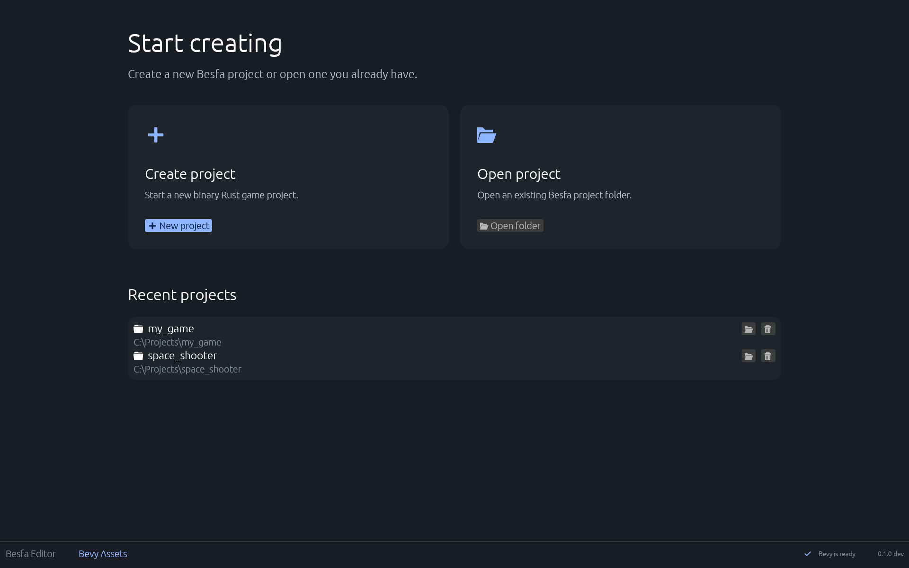
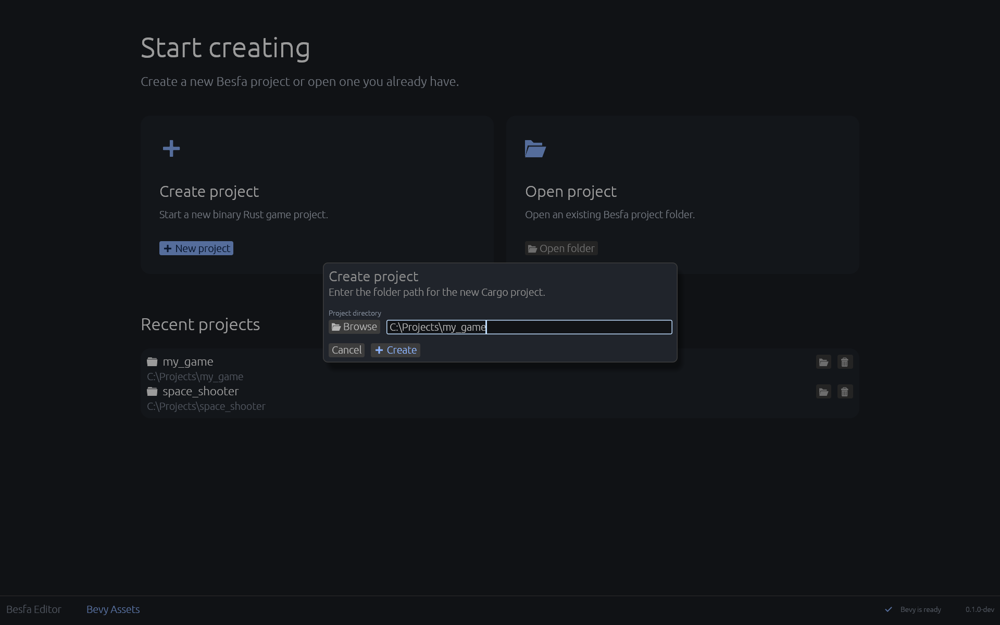

[← 사용 설명서 목차](README.md)

# 설치와 시작

Besfa를 설치하고, 에디터를 켜고, 첫 프로젝트를 만들어 여는 데까지 안내합니다.

- [준비물](#준비물)
- [설치](#설치)
- [에디터 실행](#에디터-실행)
- [Bevy 미리 빌드](#bevy-미리-빌드)
- [프로젝트 허브](#프로젝트-허브)
- [새 프로젝트 만들기](#새-프로젝트-만들기)
- [있는 프로젝트 열기](#있는-프로젝트-열기)
- [최근 프로젝트 목록](#최근-프로젝트-목록)
- [프로젝트 폴더에 생기는 것](#프로젝트-폴더에-생기는-것)

## 준비물

- **Windows**. 에디터는 Windows에서만 돌아갑니다(DirectX 12로 그립니다).
- **Rust**. [rustup.rs](https://rustup.rs/)에서 설치합니다. 설치한 뒤 터미널에서 `cargo --version`이 버전을 출력하면 됩니다.
- **Visual Studio C++ 빌드 도구와 Windows SDK**. Windows의 Rust는 이것이 있어야 컴파일됩니다. rustup 설치 프로그램이 없으면 설치하라고 안내합니다. Windows SDK가 있으면 게임의 셰이더도 빠르게 컴파일됩니다([게임 화면이 느려요](16-troubleshooting.md#게임-화면이-느려요)).
- **Git**. 에디터 소스를 받을 때 씁니다.

## 설치

에디터는 아직 설치 파일이 없어서 소스에서 빌드합니다. 터미널(PowerShell이나 Git Bash)을 열고 차례로 실행하세요.

### 1. 소스 받기

```bash
git clone https://github.com/ski0090/besfa.git
```

```bash
cd besfa
```

이후 명령은 모두 이 `besfa` 폴더에서 실행합니다.

### 2. `besfa` 명령(CLI) 설치

에디터는 프로젝트를 만들 때와 Bevy를 미리 빌드할 때 `besfa`라는 명령을 씁니다. 먼저 이 명령을 설치합니다.

```bash
cargo install --path crates/besfa_cli
```

`~/.cargo/bin/besfa.exe`가 설치됩니다. 설치됐는지 확인하세요.

```bash
besfa --version
```

버전이 나오지 않으면 `~/.cargo/bin`이 PATH에 있는지 확인하세요(rustup이 보통 넣어 줍니다). 새로 연 터미널에서 다시 해 보세요.

## 에디터 실행

`besfa` 폴더에서 실행합니다.

```bash
cargo run -p besfa_editor
```

처음에는 에디터를 컴파일하느라 몇 분 걸립니다. 다음부터는 금방 뜹니다.

아직 바탕화면 아이콘 같은 바로가기는 없습니다. 에디터를 켤 때마다 `besfa` 폴더에서 이 명령을 실행하세요.

> CLI를 설치하기 전에 에디터를 켜 두었다면, 에디터를 껐다가 다시 켜세요. 그래야 에디터가 새로 설치된 `besfa`를 찾습니다.

## Bevy 미리 빌드

에디터는 켜질 때마다 뒤에서 Bevy를 미리 컴파일합니다(**Bevy 미리 빌드**). 미리 빌드해 둔 Bevy를 모든 프로젝트가 같이 쓰므로, 게임을 실행할 때는 내 게임 코드만 컴파일하면 됩니다.

- 진행 상황은 허브 아래쪽(오른쪽)과 에디터 툴바 오른쪽 끝에 한 줄로 나옵니다. cargo가 마지막으로 출력한 줄과 `완료/전체` 진행률이 보입니다.
- 끝나면 **Bevy is ready**가 나옵니다. 실패하면 실패한 종료 코드가 나옵니다.
- 미리 빌드가 끝날 때까지 **Play** 버튼은 눌리지 않고, 열어 둔 프로젝트의 게임도 시작하지 않습니다. 끝나면 저절로 시작합니다.
- **처음 한 번은 Bevy 전체를 컴파일하므로 오래 걸립니다**(컴퓨터에 따라 십여 분 이상). 그다음부터는 바뀐 것이 없으면 금방 끝납니다.

미리 빌드한 결과는 `%LOCALAPPDATA%\Besfa` 폴더에 있습니다.

## 프로젝트 허브

에디터를 켜면 처음 보이는 화면이 **프로젝트 허브**입니다. 여기서 프로젝트를 만들거나 엽니다.



- **Create project** 카드의 **➕ New project**: 새 프로젝트를 만듭니다.
- **Open project** 카드의 **🗁 Open folder**: 이미 있는 프로젝트 폴더를 엽니다.
- **Recent projects**: 최근에 연 프로젝트 목록입니다.
- 아래쪽 **Bevy Assets** 링크: 기본 브라우저로 Bevy 커뮤니티의 플러그인·에셋 목록(<https://bevy.org/assets/>)을 엽니다. Unity의 Asset Store 같은 곳입니다.
- 오른쪽 아래: [Bevy 미리 빌드](#bevy-미리-빌드) 상태와 에디터 버전.

## 새 프로젝트 만들기

1. 허브에서 **➕ New project**를 누릅니다.
2. **Create project** 창이 뜨면 **Project directory** 칸에 새 프로젝트 폴더의 경로를 씁니다. 예: `C:\Projects\my_game`
   - **🗁 Browse**를 누르면 폴더를 고를 수 있습니다. 고른 폴더 안에 `new_project`라는 이름이 붙으니, 이름을 원하는 것으로 고치세요.
3. **➕ Create**를 누르거나 Enter를 누릅니다.



- 그 경로의 폴더는 **아직 없어야** 합니다. 에디터가 새로 만듭니다.
- **폴더 이름이 프로젝트 이름**이 됩니다. 위 예에서는 `my_game`입니다.
- 만드는 동안 **Creating…**이 보입니다. 다 만들면 바로 그 프로젝트의 편집 화면이 열립니다.
- 실패하면 창 안에 빨간 글씨로 이유가 나옵니다.

새 프로젝트에는 돌아가는 큐브 하나, 조명, 카메라가 든 씬이 들어 있습니다. 편집 화면이 열리면 게임을 빌드해서 실행하는데, 처음에는 게임 코드를 컴파일하느라 잠시 걸립니다. 진행 상황은 아래 **Log** 탭에 나옵니다. 다음은 [화면 둘러보기](02-screen-layout.md)를 보세요.

### 터미널에서 만들기

에디터 없이 터미널에서도 같은 프로젝트를 만들 수 있습니다.

```bash
besfa new C:\Projects\my_game
```

만든 뒤 허브의 **Open folder**로 열면 됩니다.

## 있는 프로젝트 열기

1. 허브에서 **🗁 Open folder**를 누릅니다.
2. 프로젝트 폴더(그 안에 `Cargo.toml`이 있는 폴더)를 고릅니다.

고른 폴더에 `Cargo.toml`이 없으면 열지 않고 허브 아래에 `'<경로>' has no Cargo.toml.`이 잠깐 나옵니다.

## 최근 프로젝트 목록

**Recent projects**에는 연 프로젝트가 최근 것부터 최대 10개까지 나옵니다.

- 프로젝트 이름이나 경로를 누르면 엽니다.
- 오른쪽 **🗁**(Show in Explorer): 탐색기에서 프로젝트 폴더를 엽니다.
- 오른쪽 **🗑**(Delete project): 확인 창(**Delete '<이름>'?**)이 뜨고, **Delete**를 누르면 프로젝트 폴더를 **휴지통**으로 옮기고 목록에서 뺍니다. 휴지통에서 되살릴 수 있습니다.
- 폴더가 지워졌거나 `Cargo.toml`이 없어진 프로젝트는 누르면 목록에서만 빠지고, 허브 아래에 `'<경로>' is no longer a Cargo project and was removed.`가 잠깐 나옵니다. 이때 폴더는 건드리지 않습니다.

목록은 `%APPDATA%\Besfa\recent_projects.json`에 저장됩니다.

## 프로젝트 폴더에 생기는 것

새 프로젝트 폴더에는 다음이 생깁니다. 보통은 직접 건드릴 일이 없지만, 무엇이 어디 있는지 알아 두면 좋습니다.

| 경로 | 무엇 |
| --- | --- |
| `Cargo.toml` | Rust 프로젝트 설정. Besfa 크레이트를 GitHub에서 받아 씁니다. |
| `Cargo.lock` | 의존성 버전 고정. 게임이 쓰는 플러그인 버전도 여기 고정됩니다([업데이트](13-updating.md#게임의-플러그인-업데이트)). 지우지 마세요. |
| `src/main.rs` | 게임 코드. 에디터가 열려 있을 때 고치면 [저절로 다시 빌드](05-play-and-save.md#코드를-고치면-다시-빌드)됩니다. |
| `assets/scenes/main.scn.ron` | 씬 파일. 에디터의 **Save scene**이 여기에 씁니다. |
| `assets/` | 모델, 프리팹 같은 에셋을 넣는 폴더. [에셋과 프리팹](07-assets-prefabs.md) 참고. |
| `.cargo/config.toml` | 미리 빌드한 Bevy를 같이 쓰게 하는 설정. |
| `.mcp.json` | Claude Code가 이 프로젝트를 다룰 때 쓰는 설정. [Claude Code로 다루기](14-claude-code.md) 참고. |

에디터를 쓰다 보면 다음도 생깁니다.

| 경로 | 무엇 |
| --- | --- |
| `besfa/snap.besfa` | 씬 뷰의 맞춤(Snap) 설정 |
| `besfa/previews/` | 모델 미리보기에서 고른 설정 |
| `screenshots/` | 모델 미리보기에서 찍은 스크린샷 |
| `target/besfa/thumbnails/` | 모델 썸네일(빌드 폴더라 버전 관리에서 빠집니다) |

---

다음: [화면 둘러보기](02-screen-layout.md)
