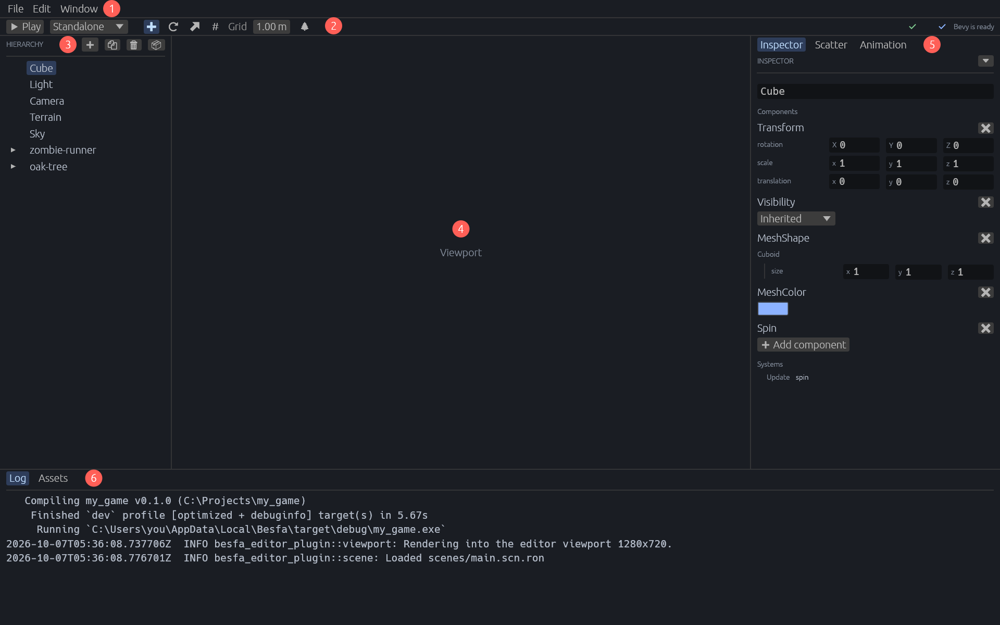
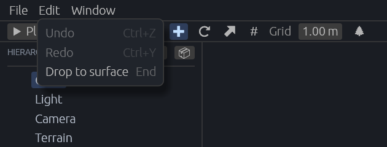

[← 사용 설명서 목차](README.md)

# 화면 둘러보기

프로젝트를 열면 나오는 편집 화면의 각 부분을 소개합니다. 번호는 아래 그림의 빨간 동그라미 번호입니다.

- [1. 메뉴](#1-메뉴)
- [2. 툴바](#2-툴바)
- [3. Hierarchy 패널](#3-hierarchy-패널)
- [4. 뷰포트](#4-뷰포트)
- [5. 오른쪽 패널: Inspector, Scatter, Animation](#5-오른쪽-패널-inspector-scatter-animation)
- [6. 아래 패널: Log와 Assets](#6-아래-패널-log와-assets)
- [창 제목](#창-제목)

> 위 그림은 설명서용으로 그린 것이라 가운데 뷰포트가 비어 있습니다. 실제 에디터에서는 이 자리에 게임 화면이 보입니다.

## 1. 메뉴

| 메뉴 | 항목 | 하는 일 |
| --- | --- | --- |
| **File** | **Save scene** (Ctrl+S) | 씬을 파일에 저장합니다. [실행과 저장](05-play-and-save.md#씬-저장) |
| | **Back to Project Hub** | 프로젝트를 닫고 허브로 돌아갑니다. |
| **Edit** | **Undo** (Ctrl+Z), **Redo** (Ctrl+Y) | 되돌리기와 다시 하기. [되돌리기](06-undo.md) |
| | **Drop to surface** (End) | 고른 물건을 아래 땅으로 내립니다. [씬 뷰 조작](04-scene-view.md#땅에-내려놓기) |
| **Window** | **Animation State Machine** | 오른쪽 패널의 Animation 탭을 엽니다. [애니메이션 상태 기계](11-animation.md) |
| | **Bevy Assets** (Ctrl+9) | 브라우저로 Bevy 커뮤니티 에셋 목록을 엽니다. |

흐리게 보이는 항목은 지금 쓸 수 없는 것입니다. 예를 들어 되돌릴 것이 없으면 **Undo**가 흐립니다.

## 2. 툴바

왼쪽부터 차례로:

| 버튼 | 하는 일 |
| --- | --- |
| **▶ Play** / **⏹ Stop** | 게임을 실행하고 멈춥니다. [실행과 저장](05-play-and-save.md#play와-stop) |
| **Standalone** 목록 | Play를 혼자 실행할지, 서버와 클라이언트로 실행할지 고릅니다. [서버와 클라이언트로 실행](05-play-and-save.md#서버와-클라이언트로-실행) |
| 이동(W)·회전(E)·크기(R) 버튼 | 씬 뷰의 핸들 종류를 고릅니다. 마우스를 올리면 이름(Move, Rotate, Scale)이 나옵니다. [핸들](04-scene-view.md#이동회전크기-핸들) |
| **#** (Snap), **Grid** | 핸들을 끌 때 일정한 간격으로 맞출지와 그 간격. [맞춤](04-scene-view.md#맞춤snap) |
| 🌲 (Scatter) | 흩뿌리기 붓을 켭니다. [흩뿌리기](10-scatter.md) |
| 오른쪽 끝 ✔ 또는 ⚠ | 게임의 플러그인 버전 상태. 누르면 업데이트합니다. [업데이트](13-updating.md#게임의-플러그인-업데이트) |
| 오른쪽 끝 **Bevy is ready** | Bevy 미리 빌드 상태. [설치와 시작](01-getting-started.md#bevy-미리-빌드) |

Play 중에는 핸들 버튼과 맞춤 버튼이 꺼집니다.

## 3. Hierarchy 패널

씬에 있는 엔티티(물건)를 트리로 보여 줍니다. 항목을 누르면 그 엔티티를 고르고, 오른쪽 Inspector에 그 엔티티의 컴포넌트가 나옵니다. 위쪽 버튼으로 엔티티를 더하고, 복제하고, 지웁니다.

자세한 내용은 [엔티티와 Inspector](03-hierarchy-inspector.md#hierarchy-패널)를 보세요.

## 4. 뷰포트

게임이 그린 화면이 나오는 곳입니다.

- **편집 상태**(Play 전)에는 편집용 카메라로 씬을 봅니다. 마우스로 카메라를 돌리고, 물건을 클릭해 고르고, 핸들로 옮깁니다. 뷰포트 왼쪽 아래에 조작법이 작게 나옵니다. [씬 뷰 조작](04-scene-view.md)
- **실행 상태**(Play 중)에는 게임 카메라의 화면이 나오고, 마우스와 키보드 입력이 게임으로 갑니다. [실행과 저장](05-play-and-save.md#실행-중-입력)

[모델 미리보기](08-model-preview.md)를 열면 뷰포트 위에 **Scene** 탭과 모델 탭이 생깁니다.

## 5. 오른쪽 패널: Inspector, Scatter, Animation

위쪽 탭으로 바꿉니다.

| 탭 | 하는 일 |
| --- | --- |
| **Inspector** | 고른 엔티티의 이름과 컴포넌트를 보여 주고 고칩니다. [엔티티와 Inspector](03-hierarchy-inspector.md#inspector-패널) |
| **Scatter** | 흩뿌릴 모델과 붓 설정. [흩뿌리기](10-scatter.md) |
| **Animation** | 고른 모델의 애니메이션 상태 기계. [애니메이션 상태 기계](11-animation.md) |

모델 미리보기 탭을 보는 동안에는 이 자리에 모델 패널이 나옵니다.

## 6. 아래 패널: Log와 Assets

| 탭 | 하는 일 |
| --- | --- |
| **Log** | 게임 빌드(cargo)와 실행 중인 게임이 출력한 글, 에디터의 알림이 나옵니다. 최근 2000줄을 보여 줍니다. |
| **Assets** | 프로젝트의 `assets` 폴더. 모델과 프리팹을 씬에 놓습니다. [에셋과 프리팹](07-assets-prefabs.md) |

빌드가 실패했거나 게임이 멈췄다면 먼저 **Log**를 보세요. 에러 메시지가 여기 나옵니다. 패널의 위쪽 경계를 끌어 높이를 바꿀 수 있습니다.

## 창 제목

창 제목에는 프로젝트 이름이 나옵니다(`my_game - Besfa Editor`). 저장하지 않은 변경이 있으면 이름 뒤에 `*`가 붙습니다(`my_game * - Besfa Editor`). [씬 저장](05-play-and-save.md#씬-저장)

---

다음: [엔티티와 Inspector](03-hierarchy-inspector.md)
