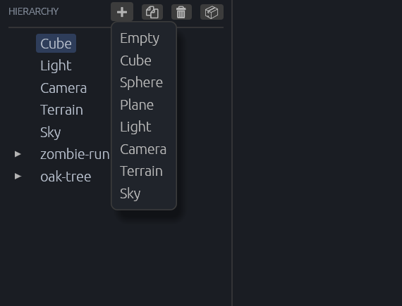
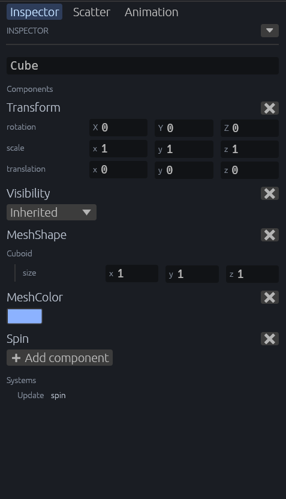

[← 사용 설명서 목차](README.md)

# 엔티티와 Inspector

씬의 물건(엔티티)을 만들고, 고르고, 컴포넌트 값을 고치는 법입니다. 왼쪽 **Hierarchy** 패널과 오른쪽 **Inspector** 패널을 씁니다.

- [Hierarchy 패널](#hierarchy-패널)
- [엔티티 만들기](#엔티티-만들기)
- [복제와 삭제](#복제와-삭제)
- [Inspector 패널](#inspector-패널)
- [값 고치기](#값-고치기)
- [여러 가지 값 칸](#여러-가지-값-칸)
- [컴포넌트 더하기와 빼기](#컴포넌트-더하기와-빼기)
- [자세히 보기](#자세히-보기)

## Hierarchy 패널

씬의 엔티티를 부모·자식 관계대로 트리로 보여 줍니다.

- 항목을 누르면 그 엔티티를 **고릅니다**. 고른 엔티티는 씬 뷰에 경계 상자와 핸들이 그려지고, Inspector에 컴포넌트가 나옵니다.
- 고른 항목을 다시 누르면 고르기를 풉니다.
- 자식이 있는 항목 앞의 삼각형(▸)은 그 아래를 접고 펼칩니다. 처음에는 모두 접혀 있습니다. 씬 뷰에서 접힌 항목 아래의 엔티티를 클릭하면 그 위가 저절로 펼쳐집니다.
- 이름이 없는 엔티티는 `Entity 4v0`처럼 번호로 나옵니다.
- **흐린 기울임 글자** 항목은 게임 코드가 실행 중에 만든 엔티티입니다. 씬 파일에 저장되지 않습니다. 씬에 놓은 모델의 부품도 흐린 글자로 나옵니다([에셋과 프리팹](07-assets-prefabs.md#놓인-모델의-부품-고치기)).

Hierarchy 위쪽 버튼(왼쪽부터):

| 버튼 | 이름 | 하는 일 |
| --- | --- | --- |
| ➕ | Add entity | 새 엔티티를 만듭니다. 아래 [엔티티 만들기](#엔티티-만들기) |
| 🗐 | Duplicate (Ctrl+D) | 고른 엔티티를 복제합니다. |
| 🗑 | Delete (Delete) | 고른 엔티티를 자식까지 지웁니다. |
| 📦 | Save as prefab | 고른 엔티티를 프리팹 파일로 저장합니다. [에셋과 프리팹](07-assets-prefabs.md#프리팹-만들기) |

버튼에 마우스를 올리면 이름이 나옵니다. 엔티티를 고르지 않았으면 ➕ 말고는 눌리지 않습니다.

## 엔티티 만들기

Hierarchy 위쪽 **➕**를 누르고 만들 것을 고릅니다. 만든 엔티티는 바로 골라집니다.

| 항목 | 만드는 것 | 놓이는 자리 |
| --- | --- | --- |
| **Empty** | 빈 엔티티(위치만 있음). 다른 엔티티를 묶는 부모로 씁니다. | 뷰포트 가운데가 가리키는 표면 위 |
| **Cube**, **Sphere** | 상자, 공 | 뷰포트 가운데가 가리키는 표면 위(바닥이 표면에 닿게) |
| **Plane** | 평평한 판 | 뷰포트 가운데가 가리키는 표면 위 |
| **Light** | 조명 | 원점 |
| **Camera** | 카메라 | 원점 |
| **Terrain** | 지형 | 원점. [지형](09-terrain.md) |
| **Sky** | 하늘 | [하늘](12-sky.md) |

"뷰포트 가운데가 가리키는 표면"은 뷰포트 한가운데에서 앞으로 쏜 선이 처음 닿는 물체의 겉면입니다. 아무것도 없으면 높이 0의 바닥입니다. 그래서 놓고 싶은 곳을 뷰포트 가운데에 두고 만들면 됩니다.

> **Terrain**이나 **Sky**가 메뉴에 없다면 게임의 플러그인이 오래된 것입니다. [플러그인을 업데이트](13-updating.md#게임의-플러그인-업데이트)하세요.

## 복제와 삭제

- **복제**: 엔티티를 고르고 🗐를 누르거나 **Ctrl+D**.
- **삭제**: 엔티티를 고르고 🗑를 누르거나 **Delete** 키. 자식 엔티티도 함께 지워집니다.
- 둘 다 [되돌리기](06-undo.md)(Ctrl+Z)로 되돌릴 수 있습니다.
- 글자 입력 칸에 커서가 있을 때는 Delete와 Ctrl+D가 글자 편집에 쓰입니다. 칸 바깥을 한 번 누른 뒤 쓰세요.

## Inspector 패널

고른 엔티티의 이름, 컴포넌트, 게임의 시스템을 보여 줍니다.

위에서부터:

1. **이름 칸**: 엔티티 이름(`Name` 컴포넌트)을 바로 고칩니다.
2. **Components**: 고칠 수 있는 컴포넌트들. 위치·회전·크기인 `Transform`이 맨 위에 옵니다. 그다음은 씬 파일에 저장되는 컴포넌트와 내 게임 코드의 컴포넌트입니다(그림의 `Spin`).
3. **➕ Add component**: 컴포넌트를 더합니다. [컴포넌트 더하기와 빼기](#컴포넌트-더하기와-빼기)
4. **Systems**: 내 게임 코드의 시스템과 그 스케줄(예: `Update spin`).

기본 보기에서는 고칠 수 있는 것만 보입니다. Bevy가 계산해서 채우는 컴포넌트(`GlobalTransform` 등)는 숨겨집니다. 모두 보려면 [자세히 보기](#자세히-보기)를 켜세요.

엔티티를 고르지 않았으면 **Select an entity in the Hierarchy**가 나옵니다.

## 값 고치기

- **숫자와 글자**: 칸을 누르고 고친 뒤 **Enter**를 누르거나 다른 곳을 누르면 반영됩니다.
- **체크 상자**: 누르는 즉시 반영됩니다.
- 고친 값은 바로 게임에 보내져 뷰포트에 보입니다. 씬에 저장하려면 [Save scene](05-play-and-save.md#씬-저장)을 하세요.
- 숫자는 소수 셋째 자리까지 보입니다.
- `Transform`의 **rotation**(회전)은 X, Y, Z 각도(도 단위)로 보이고 고칩니다.
- 흐리게 보이는 값은 읽기 전용입니다(다른 컴포넌트에서 계산되는 값 등).

## 여러 가지 값 칸

값의 종류에 따라 칸 모양이 다릅니다.

| 값 | 보이는 모양 | 고치는 법 |
| --- | --- | --- |
| 색 | 색 단추 | 누르면 색 고르기 창이 열리고, 바꾸는 대로 반영됩니다. |
| 정해진 선택지 | 목록 상자(예: `Visibility`의 Inherited, Hidden, Visible) | 목록에서 고릅니다. |
| 벡터(숫자 2~4개) | 한 줄의 x, y, z 칸 | 칸마다 숫자를 고칩니다. |
| 목록 | 항목마다 `#0`, `#1`… 번호 아래에 펼쳐짐 | 목록 이름 옆 **➕**는 마지막 항목을 복사해 끝에 더하고, 항목 옆 **🗙**는 그 항목을 뺍니다. |
| 비어 있을 수 있는 값(Option) | 비었으면 `None`과 **➕** | **➕**로 기본값을 넣고, 이름 옆 **🗙**로 다시 비웁니다. |
| 길이가 정해진 배열 | 목록처럼 보이지만 **➕**/**🗙**가 없음 | 항목 값만 고칩니다. |
| 이름표가 붙은 값 묶음(맵) | 항목마다 이름표(키) 아래에 펼쳐짐 | 맵 이름 옆 칸에 새 키를 쓰고 **➕**로 더하고, 항목 옆 **🗙**로 뺍니다. 빈 키나 이미 있는 키는 더할 수 없습니다. |

## 컴포넌트 더하기와 빼기

- **더하기**: **➕ Add component**를 누르면 **Add component** 창이 뜹니다. **Search components** 칸에 이름 일부를 쓰고 목록에서 고르면 기본값으로 붙습니다. 목록에는 게임이 알려 준 컴포넌트 중 그 엔티티에 아직 없는 것만 나옵니다.
- **빼기**: 컴포넌트 이름 오른쪽 끝의 **🗙**(X 모양) 단추(Remove component)를 누릅니다.

둘 다 [되돌리기](06-undo.md)로 되돌릴 수 있습니다.

## 자세히 보기

Inspector 위쪽 오른쪽 끝의 **⏷** 단추(Show details)를 누르면 자세히 보기로 바뀝니다. 다시 누르면(**⏶**, Hide details) 기본 보기로 돌아옵니다.

자세히 보기에서는:

- 엔티티의 **모든** 컴포넌트와 게임의 **모든** 시스템이 크레이트(Rust 패키지)별로 묶여 나옵니다. 내 게임 크레이트와 저장되는 컴포넌트가 있는 묶음은 펼쳐져 있습니다.
- 컴포넌트에 표시가 붙습니다.
  - `no Reflect`: 에디터가 값을 읽을 수 없는 컴포넌트
  - `required by X`: 컴포넌트 X가 필요로 해서 저절로 붙은 것
  - `computed`: Bevy가 다른 값에서 계산하는 것(저장되지 않음)
  - `immutable`: 바꿀 수 없는 것

> 내 게임의 컴포넌트를 Inspector에서 고치려면 그 컴포넌트에 `#[derive(Reflect)]`와 `#[reflect(Component)]`가 있어야 합니다. 새 프로젝트의 `Spin`을 참고하세요.

## 특별한 엔티티를 골랐을 때

- **지형**을 고르면 Inspector 맨 위에 지형 도구가 나옵니다. [지형](09-terrain.md)
- **씬에 놓은 모델이나 프리팹**, 또는 그 부품을 고르면 Inspector 위에 어디서 왔는지 알려 주는 글과 **⮉ Apply to prefab** 단추가 나올 수 있습니다. [에셋과 프리팹](07-assets-prefabs.md)

---

다음: [씬 뷰 조작](04-scene-view.md)
