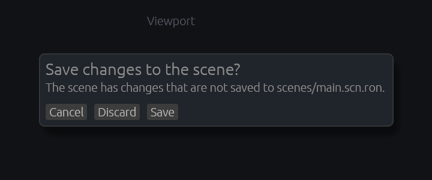
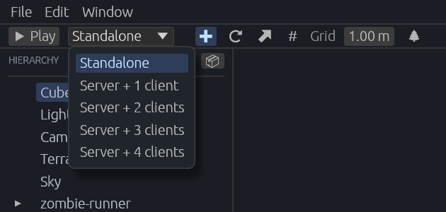

[← 사용 설명서 목차](README.md)

# 실행과 저장

에디터 안에서 게임을 실행해 보고, 고친 씬을 파일에 저장하는 법입니다.

- [편집 상태와 실행 상태](#편집-상태와-실행-상태)
- [Play와 Stop](#play와-stop)
- [실행 중 입력](#실행-중-입력)
- [씬 저장](#씬-저장)
- [저장하지 않고 나갈 때](#저장하지-않고-나갈-때)
- [코드를 고치면 다시 빌드](#코드를-고치면-다시-빌드)
- [서버와 클라이언트로 실행](#서버와-클라이언트로-실행)

## 편집 상태와 실행 상태

에디터에서 게임은 늘 실제로 실행되고 있습니다. 다만 두 가지 상태가 있습니다.

| | 편집 상태 | 실행 상태 |
| --- | --- | --- |
| 언제 | 프로젝트를 열었을 때, Stop을 누른 뒤 | Play를 누른 뒤 |
| 게임 시간 | 멈춤. 씬이 시작할 때 모습 그대로 서 있습니다. | 흐름. 게임이 돌아갑니다. |
| 뷰포트 | 편집용 카메라로 본 [씬 뷰](04-scene-view.md) | 게임 카메라의 화면 |
| 마우스·키보드 | 에디터가 씀(고르기, 핸들, 단축키) | 게임으로 감 |
| 씬 고치기 | 됨 | 저장할 수 없음(Stop하면 사라짐) |

프로젝트를 열면 에디터가 게임을 빌드해 편집 상태로 띄웁니다. 빌드 과정과 게임이 출력하는 글은 아래 **Log** 탭에 나옵니다.

> 편집 상태에서도 시간과 상관없는 게임 코드는 돌아갑니다. 시간을 쓰는 코드(예: 새 프로젝트의 큐브 돌리기)는 Play를 눌러야 움직입니다.

## Play와 Stop

- 툴바의 **▶ Play**를 누르면 게임 시간이 흐르기 시작합니다(실행 상태). 버튼은 **⏹ Stop**으로 바뀌고 Log는 비워집니다.
- **저장하지 않은 변경이 있으면 Play가 먼저 저장합니다.** 그래서 Stop한 뒤에도 Play 전에 고친 내용이 남습니다.
- **⏹ Stop**을 누르면 게임을 끄고 편집 상태로 **다시 실행**합니다.
  - 씬은 파일에 저장된 모습으로 돌아갑니다. 실행 중에 바뀐 것은 모두 사라집니다.
  - 그사이 고친 게임 코드도 새로 빌드되어 반영됩니다.
- 게임이 아직 빌드 중일 때 누른 Play는 기억해 두었다가 게임이 뜨면 바로 실행합니다.
- 빌드가 실패했거나 게임이 멈춰 꺼진 뒤에 Play를 누르면, 게임을 다시 빌드해 바로 실행 상태로 띄웁니다.
- [Bevy 미리 빌드](01-getting-started.md#bevy-미리-빌드) 중에는 Play가 눌리지 않습니다.

## 실행 중 입력

실행 상태에서는 뷰포트가 게임 창처럼 동작합니다.

- **Play**를 누르거나 뷰포트를 클릭하면 뷰포트가 키보드 포커스를 받고, 키 입력이 게임으로 갑니다.
- 뷰포트 바깥을 클릭하면 포커스를 잃고, 게임이 누르고 있던 키를 모두 뗀 것으로 처리합니다.
- 마우스 버튼, 움직임, 휠도 게임으로 갑니다.
- 실행 중에는 Delete, Ctrl+D, Ctrl+Z 같은 에디터 단축키가 꺼집니다.
- **Caps Lock**과 **Ctrl+C·X·V**는 게임에 가지 않습니다. 키를 누르고 있을 때의 반복 입력도 보내지 않습니다.

### 게임 코드를 쓰는 사람을 위한 참고

- 키는 `ButtonInput<KeyCode>`(물리 키, 자판 배열과 무관)와 `ButtonInput<Key>`(이름 있는 키와 입력한 글자)로 들어옵니다.
- 마우스는 `ButtonInput<MouseButton>`, `MouseMotion`, `AccumulatedMouseMotion`, `MouseWheel`, `AccumulatedMouseScroll`, 뷰포트 좌표의 `CursorMoved`로 들어옵니다.
- 게임에는 창이 없으므로 `Window::cursor_position`은 비어 있습니다.
- 게임 UI 버튼은 `PointerClick`·`PointerOver` 같은 picking 이벤트로 눌립니다(UI 루트에 그 카메라의 `UiTargetCamera`가 있어야 합니다). bevy_ui의 `Interaction`은 창 카메라만 보므로 `None`으로 남습니다.

## 씬 저장

씬은 프로젝트의 `assets/scenes/main.scn.ron` 파일 하나에 저장됩니다. 게임은 시작할 때 이 파일을 읽어 씬을 만듭니다.

- **File > Save scene** 또는 **Ctrl+S**로 저장합니다.
- 저장하면 Log에 `Saved scenes/main.scn.ron`이 나옵니다. 실패하면 `Could not save scenes/main.scn.ron: <이유>`가 나옵니다.
- 편집 상태에서 씬을 고치면 창 제목의 프로젝트 이름 뒤에 `*`가 붙고, 저장하면 사라집니다.
- **실행 중에는 저장할 수 없습니다**(메뉴가 흐림). 실행 중에 바뀐 모습이 저장되지 않게 하려는 것입니다.
- 지형을 칠한 결과도 Save scene이 함께 저장합니다.

## 저장하지 않고 나갈 때

저장하지 않은 변경(`*`)이 있는데 **File > Back to Project Hub**를 누르거나 창을 닫으면(제목 표시줄의 닫기, Alt+F4) 물어봅니다.

| 단추 | 하는 일 |
| --- | --- |
| **Save** | 저장한 뒤 나갑니다. 저장이 실패하면 나가지 않고 머뭅니다(이유는 Log에). |
| **Discard** | 저장하지 않고 나갑니다. 고친 내용은 사라집니다. |
| **Cancel** | 나가지 않습니다. |

게임이 떠 있지 않거나 실행 중이면 **Save** 단추가 없습니다.

## 코드를 고치면 다시 빌드

에디터가 열려 있는 동안 프로젝트 `src` 폴더의 `.rs` 파일을 고쳐 저장하면, 에디터가 알아채고 게임을 다시 빌드합니다.

1. 파일이 바뀐 뒤 0.5초 동안 더 바뀌지 않으면 Log에 `Source changed; rebuilding.`이 나옵니다.
2. 저장하지 않은 씬 변경이 있으면 먼저 씬을 저장합니다.
3. 게임을 끄고 새로 빌드해 편집 상태로 다시 띄웁니다.

- 실행 중, 게임을 띄우는 중, Bevy 미리 빌드 중에는 다시 빌드하지 않습니다. 실행 중이라면 Stop이 어차피 다시 빌드합니다.
- 마지막 빌드가 실패해서 게임이 없을 때도, 코드를 고치면 다시 빌드합니다. 컴파일 에러를 고치면 저절로 다시 뜹니다.

## 서버와 클라이언트로 실행

멀티플레이 게임을 시험할 때 씁니다. Play 버튼 오른쪽 목록에서 고릅니다.

| 항목 | Play가 하는 일 |
| --- | --- |
| **Standalone** | 게임 하나를 뷰포트에서 실행합니다(기본). |
| **Server + 1 client** ~ **Server + 4 clients** | 창 없는 데디케이트 서버 하나와 그 서버에 들어가는 클라이언트들을 띄웁니다. |

- 서버로 Play하면 먼저 씬을 저장하고, 편집 중인 게임을 끈 뒤 서버와 클라이언트를 띄웁니다.
- 첫 번째 클라이언트는 뷰포트에서 플레이하고, 나머지는 각자 창으로 뜹니다.
- 서버와 창 클라이언트의 출력은 Log에 `[server]`, `[client 2]`처럼 앞에 이름이 붙어 나옵니다.
- **⏹ Stop**은 서버와 클라이언트를 모두 끄고 편집 상태로 다시 띄웁니다.
- 실행 중에는 목록을 바꿀 수 없습니다. 목록은 기억하지 않아 프로젝트를 열 때마다 **Standalone**으로 돌아옵니다.

> 이 기능을 쓰려면 게임 코드가 서버와 클라이언트를 지원해야 합니다(`besfa_net` 크레이트). 에디터가 게임에 서버인지 클라이언트인지 알리는 방법은 개발자 문서 [아키텍처 - 서버와 클라이언트로 Play](../ARCHITECTURE.md#서버와-클라이언트로-play)를 보세요.

---

다음: [되돌리기](06-undo.md)
