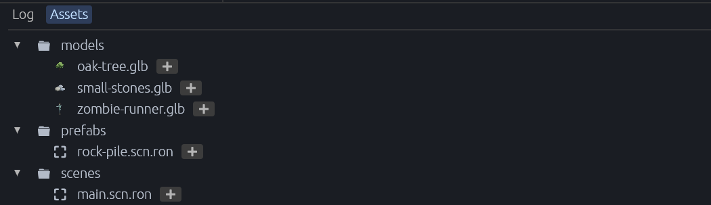

[← 사용 설명서 목차](README.md)

# 에셋과 프리팹

프로젝트의 `assets` 폴더에 있는 3D 모델과 프리팹을 씬에 놓고, 프리팹을 만들고 고치는 법입니다.

- [Assets 탭](#assets-탭)
- [씬에 놓기](#씬에-놓기)
- [놓인 모델의 부품 고치기](#놓인-모델의-부품-고치기)
- [모델 파일이 바뀌면](#모델-파일이-바뀌면)
- [프리팹 만들기](#프리팹-만들기)
- [프리팹 고치기](#프리팹-고치기)

## Assets 탭

아래 패널의 **Assets** 탭은 프로젝트의 `assets` 폴더를 트리로 보여 줍니다.

- 폴더가 먼저, 그다음 파일이 이름순으로 나옵니다. 숨김 파일은 나오지 않습니다.
- 폴더 앞의 삼각형으로 접고 펼칩니다. 처음에는 펼쳐져 있습니다.
- 탐색기에서 파일을 넣거나 지우면 저절로 다시 읽습니다.
- **모델 파일(`.glb`, `.gltf`)** 줄에는 모델의 작은 썸네일이 보이고, 이름에 마우스를 올리면 큰 썸네일이 나옵니다. 썸네일은 게임이 그리므로 게임이 떠 있어야 생깁니다. 한 번 그리면 다음에 열 때 바로 보입니다.
- 모델 파일을 **더블클릭**하면 [모델 미리보기](08-model-preview.md)가 열립니다.

모델은 Blender 같은 도구에서 glTF(`.glb` 또는 `.gltf`)로 내보내 `assets` 폴더 안에 넣으세요. 하위 폴더를 만들어도 됩니다(예: `assets/models/`).

## 씬에 놓기

씬에 놓을 수 있는 파일은 **glTF 모델(`.glb`, `.gltf`)**과 **씬·프리팹 파일(`.scn.ron`)**입니다. 두 가지 방법이 있습니다.

- **끌어 놓기**: Assets 탭의 파일을 뷰포트로 끌어 원하는 자리에 놓습니다. 끄는 동안 놓일 자리에 반투명 미리보기가 따라옵니다.
- **➕ 단추**(Add to scene): 파일 이름 옆의 ➕를 누르면 뷰포트 **가운데**가 가리키는 자리에 놓습니다.

놓이는 자리는:

- 그곳에 보이는 물체의 겉면 위
- 물체가 없으면 높이 0의 바닥
- 지평선 위(하늘)를 가리키면 씬 뷰가 바라보는 점

땅이 기울어 있어도 물건은 똑바로 서고, 모델의 원점이 그 자리에 옵니다.

놓으면 **파일 이름의 엔티티**가 생기고, 그 아래에 파일의 내용(모델의 부품, 프리팹 안의 엔티티)이 펼쳐집니다.

- 펼쳐진 내용은 Hierarchy에 **흐린 글자**로 보입니다. 씬 파일에는 놓인 파일의 경로만 저장되고, 내용은 열 때마다 파일에서 다시 펼쳐집니다.
- 뷰포트에서 부품을 클릭하면 놓인 엔티티 전체가 골라집니다. 부품 하나를 고르려면 Hierarchy에서 고르세요.
- 실행 중에는 놓을 수 없습니다.

## 놓인 모델의 부품 고치기

놓인 glTF 모델의 일부만 바꿀 수 있습니다. 예: 캐릭터의 모자 숨기기, 상자 뚜껑 열기.

1. Hierarchy에서 놓인 모델을 펼치고 바꿀 부품을 고릅니다.
2. Inspector에서 컴포넌트를 고칩니다. 예: `Visibility`를 `Hidden`으로(숨기기), `Transform`으로 옮기거나 돌리기.

- 이런 부품을 고르면 Inspector에 **`Part of <파일>; changes to it are saved on the placed model.`**이 나옵니다.
- 바꾼 내용은 놓인 모델(루트 엔티티)의 `PartChanges` 컴포넌트에 기록되고 씬과 함께 저장됩니다. 모델이 다시 펼쳐질 때마다(씬을 열 때, 모델 파일이 바뀌었을 때) 다시 적용됩니다.
- 바꾼 것을 모두 버리려면 놓인 모델을 고르고 `PartChanges` 컴포넌트를 빼세요(🗙). 부품이 파일 그대로 돌아옵니다. 되돌리기로 다시 붙이면 바꾼 것도 돌아옵니다.

## 모델 파일이 바뀌면

Blender에서 모델을 다시 내보내 파일이 바뀌면, 에디터가 알아채고 게임에 다시 읽게 합니다(**다시 가져오기**).

- 파일이 바뀐 뒤 1초 동안 더 바뀌지 않으면 다시 읽습니다. Assets 탭을 보고 있지 않아도 됩니다.
- 씬에 놓인 그 모델과 미리보기 중인 그 모델이 새 파일로 다시 펼쳐집니다.
- Assets 탭의 그 파일 줄(과 미리보기 패널의 모델 이름 옆)에 진행 중이면 도는 표시, 끝나면 5초 동안 ✔, 실패하면 ⚠가 나옵니다. ⚠에 마우스를 올리면 이유가 보이고, Log에도 남습니다.
- 게임이 떠 있지 않으면 아무것도 하지 않습니다. 게임이 시작할 때 새 파일을 읽습니다.
- `.gltf`는 그 파일 자체만 봅니다. 같이 쓰는 `.bin`이나 텍스처 파일만 바뀐 것은 알아채지 못합니다. `.glb`를 쓰면 이런 걱정이 없습니다.

## 프리팹 만들기

여러 엔티티를 하나로 묶어 파일로 저장해 두면, 씬 여러 곳에 놓고 한꺼번에 고칠 수 있습니다.

1. 프리팹으로 만들 엔티티를 고릅니다. 여러 개를 묶으려면 먼저 **Empty** 엔티티 아래에 모으세요.
2. Hierarchy 위쪽 **📦**(Save as prefab)를 누릅니다.
3. **Prefab name** 칸에 이름을 쓰고 **Save**를 누릅니다. 이름에는 영문자, 숫자, 공백, `-`, `_`만 쓸 수 있습니다.

`assets/prefabs/<이름>.scn.ron`에 저장됩니다. 이제 Assets 탭에서 이 파일을 씬에 놓을 수 있습니다.

## 프리팹 고치기

놓인 프리팹(또는 그 안쪽 엔티티)을 고르면 Inspector에 **⮉ Apply to prefab** 단추가 나옵니다.

1. 놓인 프리팹 안쪽을 고칩니다(값 고치기, 엔티티 지우기 등).
2. **⮉ Apply to prefab**을 누릅니다.

- 그 프리팹의 지금 모습이 프리팹 파일에 쓰이고, 같은 파일을 놓은 **모든** 곳이 새 모습으로 바뀝니다.
- **주의**: 그 전에 안쪽에서 고친 것은 [되돌리기](06-undo.md)로 되돌릴 수 없게 됩니다.
- glTF 모델은 파일로 되돌려 쓸 수 없어 이 단추가 없습니다. 모델은 [부품 고치기](#놓인-모델의-부품-고치기)를 쓰세요.
- 프리팹 안쪽 엔티티를 고르면 Inspector에 `Part of <파일>; Save scene skips it.`이 나옵니다. 이 엔티티의 변경은 Save scene이 아니라 Apply to prefab으로 저장한다는 뜻입니다.
- 놓인 프리팹을 다른 프리팹으로 바꾸려면 Inspector에서 `DynamicWorldRoot`의 경로를 고치세요.

---

다음: [모델 미리보기](08-model-preview.md)
