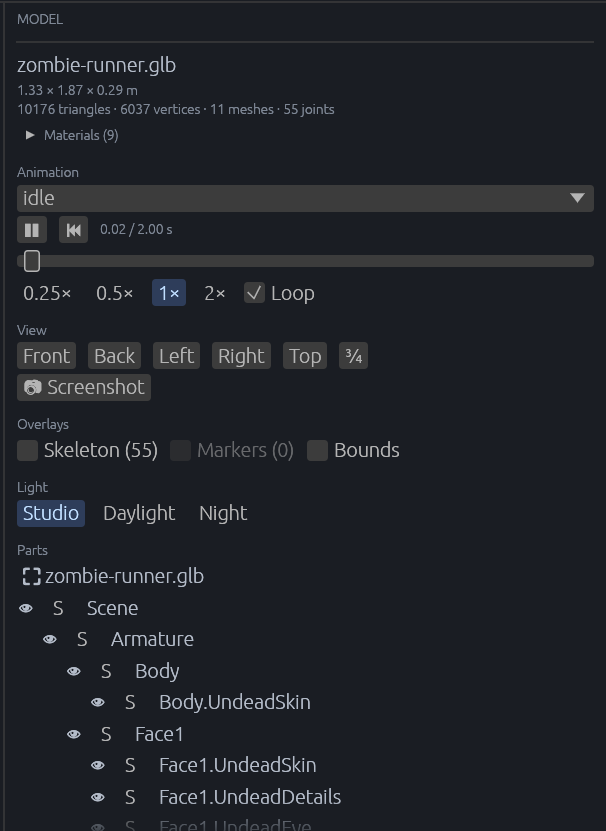

[← 사용 설명서 목차](README.md)

# 모델 미리보기

glTF 모델 하나를 씬과 떼어 따로 봅니다. 크기와 구성을 확인하고, 애니메이션을 틀어 보고, 부품을 숨기거나 움직여 자세를 잡고, 스크린샷을 찍을 수 있습니다.

- [열기와 닫기](#열기와-닫기)
- [카메라 조작](#카메라-조작)
- [모델 패널](#모델-패널)
- [애니메이션 재생](#애니메이션-재생)
- [시점과 스크린샷](#시점과-스크린샷)
- [덧그리기와 조명](#덧그리기와-조명)
- [부품 보기와 고르기](#부품-보기와-고르기)
- [자세 잡기](#자세-잡기)
- [설정이 저장되는 곳](#설정이-저장되는-곳)

## 열기와 닫기

1. 아래 **Assets** 탭에서 `.glb` 또는 `.gltf` 파일을 **더블클릭**합니다.
2. 뷰포트 위에 **Scene** 탭과 모델 탭(`⛶ 모델이름.glb`)이 생기고, 뷰포트에 그 모델만 보입니다. 오른쪽 패널은 모델 패널로 바뀝니다.

- **Scene** 탭을 누르면 씬으로 돌아가고, 모델 탭을 누르면 다시 모델을 봅니다.
- 모델 탭 옆의 **🗙**(Close the preview)로 미리보기를 닫습니다.
- **Play**를 누르면 Scene 탭으로 돌아갑니다. 실행 중에는 모델 탭을 누를 수 없습니다.
- 미리보기 중에는 씬 단축키(Delete, Ctrl+D, 되돌리기, W·E·R)와 툴바 도구, 뷰포트로 끌어 놓기가 쉽니다.

모델은 씬과 다른 곳에 따로 만들어지므로 씬의 물건이 보이거나 모델을 비추지 않고, Hierarchy와 씬 파일에도 들어가지 않습니다. 그래도 게임 안에서 만들어지므로 게임이 모델에 거는 머티리얼·셰이더 처리는 그대로 받습니다.

## 카메라 조작

| 조작 | 하는 일 |
| --- | --- |
| 왼쪽 또는 오른쪽 버튼 끌기 | 모델을 중심으로 돌기 |
| 가운데 버튼 끌기 | 옮기기 |
| 휠 | 다가가기, 멀어지기 |
| **F** | 모델이 화면에 꽉 차게 다시 맞추기 |

처음에는 모델 크기에 맞춰, 모델의 앞쪽(-Z)을 위에서 비스듬히 봅니다. 바닥에는 1 m 간격 그리드와 원점의 X·Y·Z 축이 그려집니다.

## 모델 패널

위에서부터:

- **파일 이름**과 크기(가로 × 높이 × 깊이, m)
- 삼각형·정점·메시·관절 수
- **Materials (n)**: 펼치면 머티리얼 목록(색, 이름, 쓰는 메시 수, 있는 텍스처)
- **Animation**: 클립 고르기와 재생. 아래 [애니메이션 재생](#애니메이션-재생)
- **View**와 **Screenshot**: 아래 [시점과 스크린샷](#시점과-스크린샷)
- **Overlays**와 **Light**: 아래 [덧그리기와 조명](#덧그리기와-조명)
- **Parts**: 부품 트리. 아래 [부품 보기와 고르기](#부품-보기와-고르기)

## 애니메이션 재생

- **Animation** 목록에서 클립을 고르면 바로 틉니다. **None (rest pose)**를 고르면 멈추고 모델을 읽었을 때의 자세로 돌아갑니다.
- **⏸/▶**: 일시정지와 재생, **⏮**: 처음으로
- 시간 막대를 끌면 멈춘 채로 그 시간의 자세를 봅니다.
- **0.25× 0.5× 1× 2×**: 재생 속도
- **Loop**: 반복 재생

편집 상태라 게임 시간은 멈춰 있지만, 미리보기의 클립은 실제 시간으로 움직입니다.

## 시점과 스크린샷

- **Front**, **Back**, **Left**, **Right**, **Top**, **¾**: 정해진 방향에서 모델을 봅니다. 앞(Front)은 모델의 -Z 쪽입니다. 고른 시점은 **F**를 누를 때와 다음에 열 때도 쓰입니다.
- **📷 Screenshot**: 뷰포트에 보이는 그대로를 프로젝트의 `screenshots/<모델>-<번호>.png`로 저장합니다. 번호는 이미 있는 파일 다음 번호입니다. 저장한 경로와 폴더 열기 단추가 옆에 나옵니다.

## 덧그리기와 조명

**Overlays**는 모델 위에 덧그려 보여 줍니다. 모두 모델 앞에 그려지고 스크린샷에도 들어갑니다.

| 항목 | 그리는 것 |
| --- | --- |
| **Skeleton (n)** | 관절과, 관절을 부모 관절과 잇는 선 |
| **Markers (n)** | `Grip`, `ShotPoint`처럼 메시 없는 표시점의 축. 표시점이 있으면 **Marker positions**를 펼쳐 위치를 봅니다. |
| **Bounds** | 모델의 경계 상자 |

**Light**는 조명을 고릅니다: **Studio**, **Daylight**, **Night**.

## 부품 보기와 고르기

**Parts**에는 모델의 노드와 메시가 트리로 나옵니다.

- 맨 위 `⛶ 모델이름` 줄은 모델이 펼쳐진 루트입니다.
- 이름을 누르면 그 부품을 고릅니다.
- **눈 아이콘**: 그 부품과 그 아래 메시를 숨기고 다시 보입니다.
- **S**: 그 부품만 보여 줍니다(나머지 숨김).
- 패널 맨 위 **MODEL** 줄 오른쪽의 👁(Show all parts): 숨긴 부품이나 단독 보기가 있을 때만 나타나고, 누르면 모두 다시 보입니다.
- 표시점에는 `marker`, 관절에는 `joint` 표시가 붙고, 패널에서 고친 부품은 강조색으로 보입니다.

## 자세 잡기

부품을 고르면 **Selected** 아래에 이름과 **Position**, **Rotation**(도), **Scale** 칸이 나옵니다. 칸을 좌우로 끌어 문 경첩이나 포탑 같은 노드를 돌리고 옮겨 자세를 잡습니다. 그 아래에는 Inspector와 같은 컴포넌트 목록과 **Add component**가 있습니다.

- 클립이 움직이는 노드는 클립이 자세를 덮어씁니다. 손으로 잡으려면 클립을 **None (rest pose)**로 두세요.
- 루트(`⛶` 줄)에 게임의 컴포넌트를 붙이면, 게임이 그 컴포넌트가 붙은 모델에만 거는 처리(예: 특정 캐릭터용 셰이더)를 미리보기에서도 볼 수 있습니다.

**Poses**:

- 이름 칸(Pose name)에 이름을 쓰고 **Save pose**: 지금 바꾼 부품들의 자세를 그 이름으로 저장합니다.
- 저장한 자세 옆 **▶**: 모든 부품을 처음 자세로 돌린 뒤 그 자세를 겁니다.
- **Rest**: 바꾼 자세를 모두 되돌립니다.

**Revert N changes**: 패널에서 모델에 한 모든 변경(자세, 컴포넌트 등)을 되돌립니다.

패널에서 한 변경은 씬의 [되돌리기](06-undo.md)와 저장하지 않은 변경 표시(`*`)에 들어가지 않습니다. 씬에 놓은 모델에도 영향을 주지 않습니다.

## 설정이 저장되는 곳

고른 클립·속도·반복·조명·시점·덧그리기·숨긴 부품·단독 보기, 그리고 패널에서 한 변경과 저장한 자세는 모델마다 프로젝트의 `besfa/previews/<에셋 경로>.besfa`에 저장됩니다. 다음에 같은 모델을 열면 그대로 이어집니다. 모델 파일을 다시 내보내도 부품 이름이 같으면 설정이 다시 걸립니다.

이 파일을 읽지 못하면 패널에 이유가 나오고, 그 파일은 덮어쓰지 않습니다.

---

다음: [지형](09-terrain.md)
