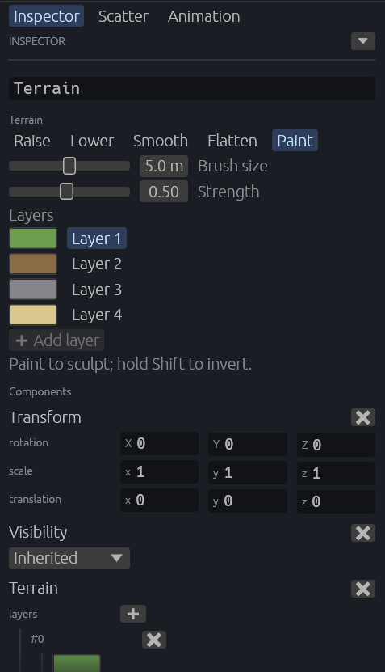

[← 사용 설명서 목차](README.md)

# 지형

땅을 만들고, 붓으로 높이를 빚고, 겉면 색을 칠합니다. 칠한 겉면 위에 풀 같은 식물을 기를 수도 있습니다.

- [지형 만들기](#지형-만들기)
- [지형 도구](#지형-도구)
- [높이 빚기](#높이-빚기)
- [겉면 칠하기](#겉면-칠하기)
- [붓 끄기](#붓-끄기)
- [저장](#저장)
- [풀 기르기(폴리지)](#풀-기르기폴리지)

## 지형 만들기

Hierarchy 위쪽 **➕**에서 **Terrain**을 고릅니다. 원점에 한 변 256 m의 평평한 지형이 생기고 골라집니다.

> 메뉴에 **Terrain**이 없으면 게임의 플러그인이 오래된 것입니다. [플러그인을 업데이트](13-updating.md#게임의-플러그인-업데이트)하세요.

## 지형 도구

지형을 고르면 Inspector 맨 위에 **Terrain** 도구가 나옵니다.

| 항목 | 하는 일 |
| --- | --- |
| **Raise** | 땅을 올립니다. |
| **Lower** | 땅을 내립니다. |
| **Smooth** | 울퉁불퉁한 곳을 고르게 합니다. |
| **Flatten** | 평평하게 만듭니다. |
| **Paint** | 겉면 색(레이어)을 칠합니다. |
| **Brush size** | 붓의 반지름(m). 0.5 m ~ 50 m |
| **Strength** | 붓의 세기. Raise·Lower는 한 획에 최대 붓 크기의 절반(m)만큼 올리고 내립니다. |

도구 단추를 누르면 붓이 켜지고, 같은 단추를 다시 누르면 꺼집니다.

## 높이 빚기

1. **Raise**, **Lower**, **Smooth**, **Flatten** 중 하나를 누릅니다.
2. 씬 뷰에서 **왼쪽 버튼을 누른 채 끌어** 칠합니다.

- 붓이 켜져 있는 동안 왼쪽 버튼은 물건 고르기 대신 칠하기가 됩니다. 마우스 아래 땅에 붓의 테두리가 그려집니다.
- 오른쪽·가운데 버튼과 휠의 카메라 조작은 그대로 쓸 수 있습니다.
- **Shift**를 누르고 있는 동안 Raise와 Lower가 서로 바뀝니다. 다른 도구에서는 Shift가 아무것도 하지 않습니다.
- 누른 뒤 뗄 때까지가 한 획이고, 한 획은 [되돌리기](06-undo.md) 한 번으로 되돌립니다.
- 붓을 쓰는 동안 지형의 핸들은 숨고, 뷰포트 왼쪽 아래 안내가 `Paint to sculpt; hold Shift to invert.`로 바뀝니다.

## 겉면 칠하기

1. **Paint**를 누르면 **Layers** 목록이 나옵니다. 레이어마다 색 단추와 **Layer 1**~**Layer 4** 단추가 있습니다.
2. 칠할 레이어 단추(예: **Layer 2**)를 누릅니다.
3. 씬 뷰에서 왼쪽 버튼으로 칠합니다.

- 색 단추를 누르면 그 레이어의 색을 바꿉니다.
- **➕ Add layer**로 레이어를 더합니다. 지형 하나에 레이어는 최대 4개이고, 4개면 단추가 꺼집니다(마우스를 올리면 `A terrain has at most 4 layers.`).
- 레이어 색 바꾸기와 더하기도 되돌리기로 되돌릴 수 있습니다.

## 붓 끄기

다음 중 하나로 붓이 꺼지고 왼쪽 버튼이 다시 고르기가 됩니다.

- 켜진 도구 단추를 다시 누르기
- **Esc**
- 다른 엔티티 고르기
- **Play**
- 모델 미리보기 탭 열기

## 저장

칠한 지형은 **File > Save scene**(Ctrl+S)이 씬과 함께 저장합니다. 높이와 겉면은 씬 파일과 따로 지형 파일에 저장됩니다.

## 풀 기르기(폴리지)

지형의 한 레이어가 덮은 곳에만 풀 같은 식물을 많이 기를 수 있습니다. 풀 레이어를 칠하면 풀이 나고, 다른 레이어로 덮으면 사라집니다.

1. 지형 엔티티를 고릅니다(또는 지형 아래에 **Empty**를 만들어 고릅니다).
2. **➕ Add component**에서 `Foliage`를 붙입니다.
3. 값을 정합니다.

| 값 | 뜻 |
| --- | --- |
| `model` | 기를 식물의 glTF 모델 경로(`assets` 기준, 예: `props/grass-clump.glb`) |
| `layer` | 식물이 자랄 지형 레이어 번호. 0부터 셉니다(Layer 1이 0). |
| `density` | 레이어가 땅을 다 덮은 곳의 1 m²당 식물 수(기본 1, 최대 64) |
| `scale` | x 칸이 가장 작은 크기, y 칸이 가장 큰 크기(기본 0.8 ~ 1.2) |
| `distance` | 카메라에서 이 거리(m) 안에서만 보입니다(기본 60). |
| `shadows` | 그림자를 드리울지(기본 꺼짐) |
| `wind` | 바람에 흔들리는 정도(기본 0.2, 0이면 멈춤). Play해야 흔들립니다. |

- 식물 하나하나는 저장되지 않습니다. 같은 지형과 같은 값이면 늘 같은 자리에 자랍니다.
- 식물 종류 하나에 `Foliage` 하나입니다. 풀과 들꽃을 같이 기르려면 지형 아래에 엔티티를 둘 두고 각자 `Foliage`를 붙이세요.
- 하나하나 베거나 캐야 하는 나무·바위는 폴리지 대신 [흩뿌리기](10-scatter.md)로 놓으세요.

> 게임 코드에서 어떤 자리의 땅 높이가 필요하면 시스템 인자 `TerrainHeight`의 `at(x, z)`를 쓰세요(캐릭터를 땅 위에 세울 때 등). 자세한 내용은 개발자 문서 [폴리지](../FOLIAGE.md)와 [프로젝트 개요](../PROJECT_OVERVIEW.md)에 있습니다.

---

다음: [흩뿌리기](10-scatter.md)
