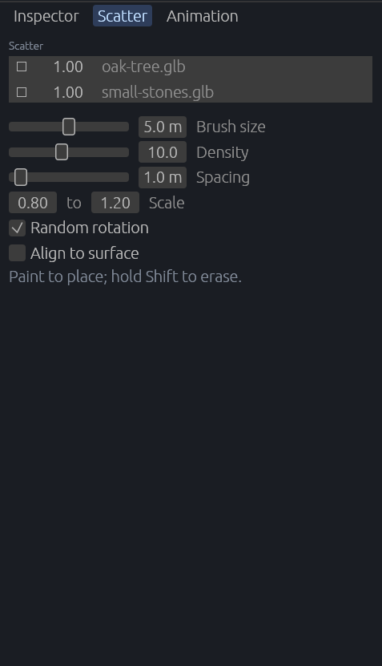

[← 사용 설명서 목차](README.md)

# 흩뿌리기

나무, 바위, 덤불 같은 물건을 붓으로 칠하듯 땅에 흩어 놓습니다. 하나하나 놓지 않아도 숲이나 돌밭을 금방 만들 수 있습니다.

- [Scatter 탭](#scatter-탭)
- [흩뿌릴 물건 고르기](#흩뿌릴-물건-고르기)
- [붓 설정](#붓-설정)
- [칠하기와 지우기](#칠하기와-지우기)
- [흩뿌린 물건은 어디로 가나](#흩뿌린-물건은-어디로-가나)

## Scatter 탭

오른쪽 패널의 **Scatter** 탭에 흩뿌릴 물건 목록과 붓 설정이 있습니다. 툴바의 나무 모양 아이콘 🌲(Scatter) 단추를 켜면 이 탭이 열립니다.

## 흩뿌릴 물건 고르기

1. 아래 **Assets** 탭을 엽니다.
2. 흩뿌릴 모델(`.glb`, `.gltf`)이나 프리팹(`.scn.ron`)을 **Scatter** 탭의 목록 자리로 끌어 놓습니다. 목록이 비어 있으면 `Drag prefabs or models here to scatter them.`이 보입니다.
3. 여러 개를 넣으면 섞어서 흩뿌립니다.

목록의 한 줄에는:

- 맨 앞 단추(Remove): 그 물건을 목록에서 뺍니다.
- 숫자: 다른 물건에 비해 얼마나 자주 나올지(0 ~ 10, 기본 1). 좌우로 끌어 바꿉니다. 예를 들어 나무 1, 바위 2면 바위가 두 배쯤 많이 나옵니다.
- 파일 이름: 마우스를 올리면 전체 경로가 보입니다.

## 붓 설정

| 설정 | 뜻 |
| --- | --- |
| **Brush size** | 붓의 반지름(m). 0.5 m ~ 50 m |
| **Density** | 붓 아래 100 m²마다 놓을 개수 |
| **Spacing** | 물건끼리 떨어져야 하는 최소 거리(m). 이미 흩뿌린 물건과의 거리도 지킵니다. |
| **Scale** | 크기의 최소 ~ 최대. 그 사이에서 무작위로 정합니다. |
| **Random rotation** | 켜면 물건마다 위 축을 중심으로 무작위로 돌려 놓습니다. |
| **Align to surface** | 켜면 땅의 기울기에 맞춰 기울여 놓습니다. |

## 칠하기와 지우기

1. 툴바의 🌲(Scatter) 단추를 켭니다. 지형 붓은 꺼집니다.
2. 씬 뷰에서 **왼쪽 버튼을 누른 채 끌어** 칠합니다. 붓 아래 땅에 목록의 물건이 놓입니다.
3. **Shift**를 누른 채 칠하면 흩뿌린 물건만 지웁니다. 손으로 놓은 물건은 지우지 않습니다.
4. 다 했으면 🌲 단추를 다시 누르거나 **Esc**로 끕니다.

- 붓을 쓰는 동안 땅에 붓의 원이 보입니다(지울 때는 붉게). 뷰포트 왼쪽 아래 안내는 `Paint to place; hold Shift to erase.`가 됩니다.
- 붓은 이미 있는 흩뿌린 물건을 세어 **밀도에 모자란 만큼만** 더합니다. 같은 곳을 여러 번 칠해도 겹겹이 쌓이지 않습니다.
- 누른 뒤 뗄 때까지가 한 번의 [되돌리기](06-undo.md)입니다.
- 목록이 비어 있으면 칠해지지 않습니다.
- 🌲 단추는 실행 중이나 모델 미리보기 중에는 꺼져 있습니다. 플러그인이 오래된 게임에서도 꺼져 있습니다([플러그인 업데이트](13-updating.md#게임의-플러그인-업데이트)).

## 흩뿌린 물건은 어디로 가나

- 흩뿌린 물건은 씬의 **Scatter** 묶음 엔티티 아래에 들어갑니다(처음 칠할 때 생기고, 되돌려도 남습니다).
- 일반 엔티티처럼 고르고, 옮기고, 지울 수 있고, Save scene으로 저장됩니다.
- 흩뿌린 물건에는 `Scattered` 표시가 붙어 있어 게임 코드가 골라낼 수 있습니다.

> 풀처럼 아주 많이 깔고 하나하나 다룰 필요가 없는 것은 흩뿌리기 대신 지형의 [폴리지](09-terrain.md#풀-기르기폴리지)를 쓰세요.

---

다음: [애니메이션 상태 기계](11-animation.md)
