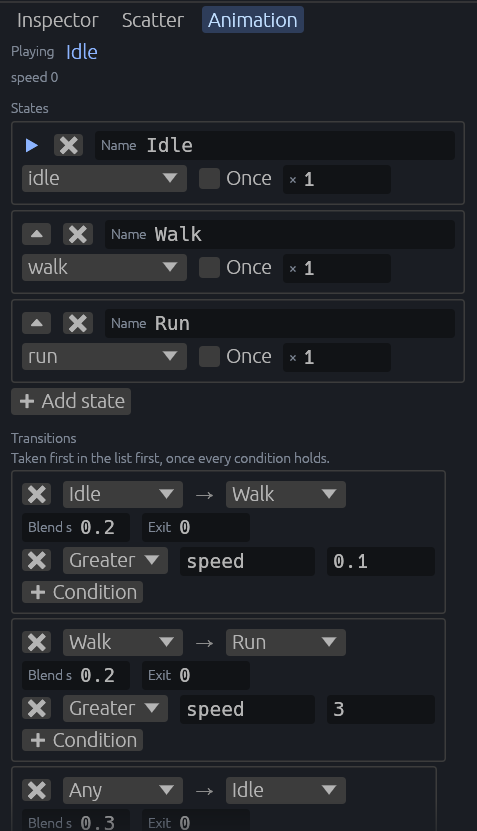

[← 사용 설명서 목차](README.md)

# 애니메이션 상태 기계

씬에 놓은 glTF 모델의 애니메이션 클립(idle, walk, run 등)을 **상태**로 만들고, 어떤 조건에서 다른 상태로 넘어갈지(**전이**)를 정합니다. 게임 코드는 "속도" 같은 **파라미터** 값만 바꾸면, 상태 기계가 알맞은 클립을 틀어 줍니다.

- [Animation 탭 열기](#animation-탭-열기)
- [상태 기계 붙이기](#상태-기계-붙이기)
- [상태(States)](#상태states)
- [전이(Transitions)](#전이transitions)
- [게임 코드에서 파라미터 쓰기](#게임-코드에서-파라미터-쓰기)
- [확인하기](#확인하기)

위 그림은 zombie 모델에 Idle, Walk, Run 세 상태를 두고, 파라미터 `speed`가 0.1보다 크면 걷고, 3보다 크면 뛰고, 0.1보다 작으면 어느 상태에서든 Idle로 돌아가게 한 예입니다.

## Animation 탭 열기

- 오른쪽 패널의 **Animation** 탭을 누르거나, **Window > Animation State Machine**을 고릅니다.
- 그다음 Hierarchy나 씬 뷰에서 **씬에 놓은 glTF 모델**을 고릅니다. 모델을 놓는 법은 [에셋과 프리팹](07-assets-prefabs.md#씬에-놓기)을 보세요.

아무것도 고르지 않았으면 `Select a placed model in the Hierarchy.`가 나옵니다.

## 상태 기계 붙이기

고른 모델에 상태 기계가 없으면 **➕ Add state machine** 단추가 나옵니다. 누르면 `AnimationStateMachine` 컴포넌트(와 파라미터를 담는 `AnimationParams`)가 붙습니다.

> `Update besfa_editor_plugin in the game to play animation state machines.`가 보이면 게임의 플러그인이 오래된 것입니다. [플러그인을 업데이트](13-updating.md#게임의-플러그인-업데이트)하세요.

맨 위에는 지금 트는 상태(**Playing**)와 게임이 쓴 파라미터 값(그림의 `speed 0`)이 보입니다. 실행 중에는 바뀌는 대로 따라갑니다.

## 상태(States)

상태 하나는 클립 하나를 트는 방법입니다.

| 칸 | 뜻 |
| --- | --- |
| **Name** | 상태 이름. 바꾸면 전이에 쓴 이름도 따라 바뀝니다. |
| 클립 목록 | 이 상태에서 틀 모델의 클립. 모델이 가진 클립 중에서 고릅니다. |
| **Once** | 켜면 한 번만 틀고 마지막 자세로 멈춥니다. 끄면 반복합니다. |
| **×** 숫자 | 재생 속도 배수(1이면 원래 속도) |

- **▶** 표시가 붙은 첫 상태에서 시작합니다.
- **⏶**(Play first): 그 상태를 첫 상태로 올립니다.
- **🗙**(Remove): 그 상태와, 그 상태로 오가는 전이를 지웁니다.
- **➕ Add state**: 아직 쓰지 않은 클립 이름으로 상태를 더합니다.

클립 목록이 비어 있고 `The model's clips show once it has loaded.`가 보이면 모델을 아직 읽는 중입니다. 잠시 기다리세요.

## 전이(Transitions)

전이는 "어느 상태에서, 어떤 조건이면, 어느 상태로" 넘어갈지입니다. 목록의 위에서부터 살피고, 모든 조건이 맞는 첫 전이를 탑니다.

한 전이에는:

| 칸 | 뜻 |
| --- | --- |
| 출발 → 도착 | 출발 상태와 도착 상태. 출발을 **Any**로 두면 도착 상태가 아닌 모든 상태에서 넘어갑니다. |
| **Blend s** | 두 클립을 섞으며 넘어가는 시간(초). 기본 0.2 |
| **Exit** | 출발 상태의 클립을 얼마나 튼 뒤에 넘어갈지. 1이면 한 바퀴, 0이면 언제든 |
| 조건들 | 아래 표. **➕ Condition**으로 더하고 🗙로 뺍니다. 조건이 하나도 없으면 Exit만 지나면 넘어갑니다. |

조건의 시험 종류:

| 시험 | 맞는 때 |
| --- | --- |
| **Greater** | 실수 파라미터가 값보다 클 때 |
| **Less** | 실수 파라미터가 값보다 작을 때 |
| **True** | 참거짓 파라미터가 참일 때 |
| **False** | 참거짓 파라미터가 거짓일 때 |
| **Trigger** | 트리거를 당겼을 때(전이를 타면 트리거는 저절로 놓입니다) |

- **➕ Add transition**으로 전이를 더하고, 전이 맨 앞의 🗙로 지웁니다.
- 칸의 값은 다른 곳을 누를 때 반영됩니다.

## 게임 코드에서 파라미터 쓰기

상태 기계는 모델의 `AnimationParams` 컴포넌트에서 파라미터를 읽습니다. 게임 코드에서 이 컴포넌트의 값을 바꾸세요.

- `floats`: 실수 파라미터(예: `speed`) → Greater, Less로 시험
- `bools`: 참거짓 파라미터 → True, False로 시험
- `triggers`: 당긴 트리거 이름 목록 → Trigger로 시험
- `state`: 지금 트는 상태 이름(상태 기계가 씁니다). 상태 이름을 쓰면 그 상태로 바로 갑니다.

한 번도 쓰지 않은 파라미터는 0과 false로 읽습니다.

## 확인하기

- 편집 상태에서는 게임 시간이 멈춰 있어 클립이 움직이지 않습니다. **Play**를 눌러 확인하세요.
- Animation 탭에서 바꾼 것은 Inspector에서 고친 것처럼 [되돌리기](06-undo.md)와 Save scene에 들어갑니다.
- 실행 중에 바꾼 것은 Stop하면 사라집니다.
- 클립 하나만 따로 틀어 보려면 [모델 미리보기](08-model-preview.md#애니메이션-재생)가 편합니다.

---

다음: [하늘](12-sky.md)
