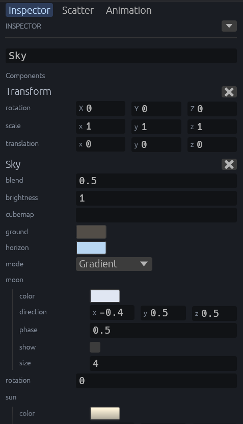

[← 사용 설명서 목차](README.md)

# 하늘

씬의 하늘색, 해와 달, 또는 하늘 그림(큐브맵)을 정합니다. 하늘은 `Sky` 컴포넌트 하나라서 다른 컴포넌트처럼 Inspector에서 고치고, 되돌리고, 씬에 저장합니다.

- [하늘 만들기](#하늘-만들기)
- [그라데이션 하늘](#그라데이션-하늘)
- [해와 달](#해와-달)
- [큐브맵 하늘](#큐브맵-하늘)
- [게임 코드에서 바꾸기](#게임-코드에서-바꾸기)

## 하늘 만들기

Hierarchy 위쪽 **➕**에서 **Sky**를 고릅니다. 기본 그라데이션 하늘을 가진 `Sky` 엔티티가 생깁니다. 고친 값은 편집 상태의 뷰포트에 바로 보이고, Save scene으로 저장합니다.



- 씬에 `Sky`가 여럿이면 처음 찾은 것을 씁니다.
- `Sky`가 없으면 하늘은 게임 기본 배경색입니다.

## 그라데이션 하늘

`mode`가 `Gradient`이면 색 세 개로 하늘을 칠합니다.

| 값 | 뜻 |
| --- | --- |
| `zenith` | 머리 위 색 |
| `horizon` | 지평선 색 |
| `ground` | 지평선 아래 색 |
| `blend` | 지평선 색이 위로 퍼지는 정도. 작을수록 머리 위 색이 넓습니다. |
| `brightness` | 밝기. 1이면 고른 색 그대로 보입니다. |
| `rotation` | 하늘을 위에서 보아 반시계로 돌리는 각도(도) |

색 칸은 색 단추라 누르면 색 고르기 창이 열립니다.

## 해와 달

그라데이션 하늘에는 해(`sun`)와 달(`moon`)을 그릴 수 있습니다. 각각 펼쳐서 고칩니다.

| 값 | 해(`sun`) | 달(`moon`) |
| --- | --- | --- |
| `show` | 보일지(기본 켜짐) | 보일지(기본 꺼짐) |
| `direction` | 보는 사람에게서 해 쪽 방향(월드 기준) | 달 쪽 방향 |
| `size` | 겉보기 지름(도, 기본 3) | 겉보기 지름(도, 기본 4) |
| `color` | 원반과 둘레 빛의 색 | 밝은 쪽의 색 |
| 그 밖 | `flare`: 렌즈 플레어 세기(0이면 없음 ~ 1) | `phase`: 0 삭, 0.25 상현(오른쪽 반), 0.5 보름, 0.75 하현(왼쪽 반) |

- 해와 달은 지평선 아래에서는 잘립니다.
- 해와 달, 렌즈 플레어는 그라데이션 모드에서만 그립니다.

## 큐브맵 하늘

그린 하늘이나 사진을 쓰려면 `mode`를 `Cubemap`으로 바꾸고 `cubemap`에 이미지 경로(`assets` 기준)를 씁니다.

- 쓸 수 있는 이미지: Bevy가 읽는 큐브맵(`.ktx2`, `.dds`), 또는 여섯 면(+X, -X, +Y, -Y, +Z, -Z)을 위에서 아래로 쌓은 PNG·JPG(높이 = 너비 × 6).
- 이미지를 읽는 동안이나 읽지 못했으면 그라데이션이 보이고, 실패하면 Log에 이유가 남습니다.
- `brightness`와 `rotation`은 큐브맵에도 쓰입니다.
- 모드를 바꿔도 다른 모드의 값은 남아 있습니다.

## 게임 코드에서 바꾸기

게임 코드가 실행 중에 `Sky` 값을 바꾸면 화면도 따라 바뀝니다. 예를 들어 하루 시계에 맞춰 하늘색과 해 방향을 바꿀 수 있습니다.

```rust
use besfa_components::Sky;

fn day_sky(mut skies: Query<&mut Sky>) {
    for mut sky in &mut skies {
        sky.zenith = Color::srgb(0.2, 0.4, 0.8);
        sky.sun.show = true;
    }
}
```

`DirectionalLight`로 해를 비추고 있다면, 해 방향은 그 빛의 `Transform`의 `back()`입니다. 더 자세한 내용은 개발자 문서 [하늘 편집](../SKY.md)에 있습니다.

---

다음: [업데이트](13-updating.md)
