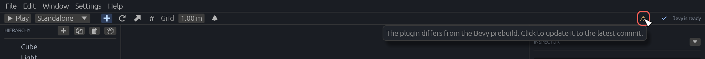
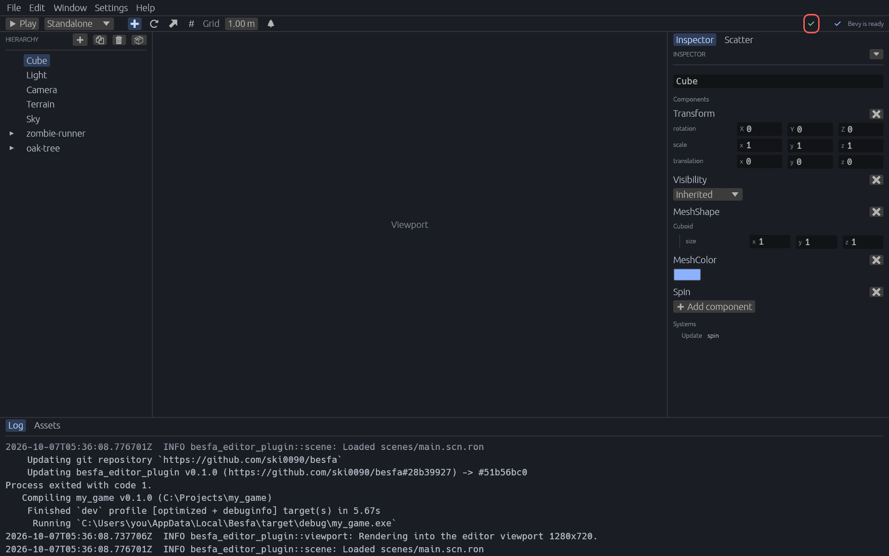

[← 사용 설명서 목차](README.md)

# 업데이트

Besfa는 두 부분을 따로 업데이트합니다.

- **에디터와 CLI**: 내 컴퓨터에 설치한 에디터와 `besfa` 명령
- **게임의 플러그인**: 각 게임 프로젝트가 쓰는 `besfa_editor_plugin`(과 `besfa_components`)

목차:

- [에디터와 CLI 업데이트](#에디터와-cli-업데이트)
- [게임의 플러그인 업데이트](#게임의-플러그인-업데이트)
- [릴리스 빌드에는 에디터가 들어가지 않습니다](#릴리스-빌드에는-에디터가-들어가지-않습니다)
- [병합 전 Besfa로 게임 빌드하기](#병합-전-besfa로-게임-빌드하기)

## 에디터와 CLI 업데이트

에디터 소스 폴더(`besfa`)에서:

```bash
git pull
```

```bash
cargo install --path crates/besfa_cli
```

그다음 에디터를 다시 시작합니다.

```bash
cargo run -p besfa_editor
```

- CLI 재설치(`cargo install`)는 `crates/besfa_cli`가 바뀌었을 때 필요합니다. 잘 모르겠으면 매번 해도 됩니다.
- 에디터는 시작할 때 [Bevy 미리 빌드](01-getting-started.md#bevy-미리-빌드)를 GitHub에 있는 최신 플러그인으로 맞춥니다. 허브 아래에 진행 상황이 나옵니다. 끝나기 전에 프로젝트를 열면 미리 빌드는 멈췄다가 허브로 돌아오면 이어집니다.

## 게임의 플러그인 업데이트

게임 프로젝트는 플러그인을 GitHub에서 받고, `Cargo.lock`이 그중 한 커밋에 고정합니다. 그래서 직접 업데이트하기 전까지는 같은 플러그인을 계속 씁니다.

에디터 툴바 오른쪽, **Bevy is ready** 왼쪽에 따로 떨어진 아이콘이 이 프로젝트의 플러그인 커밋을 Bevy 미리 빌드의 커밋과 비교해 보여 줍니다(**Bevy is ready** 글자 바로 앞의 ✔는 미리 빌드 상태라 다른 것입니다. 미리 빌드가 끝나기 전에 프로젝트를 열었다면 그 자리에 `Bevy prebuild paused for the project` ⏸가 나옵니다).

| 아이콘 | 뜻 |
| --- | --- |
| 초록 ✔ | 같은 커밋입니다. 그대로 쓰면 됩니다. |
| 노란 ⚠ | 다른 커밋이거나, 에디터와 대화하는 방식(프로토콜)이 다릅니다. 마우스를 올리면 이유와 누르면 무엇을 하는지 나옵니다. |



**아이콘을 누르면 업데이트합니다.**

1. 저장하지 않은 변경(`*`)이 있으면 먼저 씬을 저장합니다. 저장이 실패하면 업데이트하지 않습니다(이유는 **Log**에). 게임과 고친 내용은 그대로 남습니다.
2. 에디터가 프로젝트에서 `cargo update -p besfa_editor_plugin`을 실행합니다. 같은 저장소의 `besfa_components`도 함께 올라가고, 다른 의존성은 건드리지 않습니다.
3. 게임을 멈추고 새 플러그인으로 다시 빌드합니다.
4. cargo의 출력이 **Log**에 나오고(`Process exited with code 1.`은 이전 게임을 멈춘 기록입니다), 아이콘이 초록으로 바뀝니다.



에디터 없이 하려면 프로젝트 폴더에서 같은 명령을 실행하세요.

```bash
cargo update -p besfa_editor_plugin
```

알아 둘 것:

- 아직 `Cargo.lock`이 없거나 플러그인을 로컬 경로로 쓰는 프로젝트에는 아이콘이 나오지 않습니다. 단, 게임이 에디터와 다른 프로토콜로 말하면 이런 프로젝트에도 ⚠가 나옵니다.
- `cargo update`가 실패하면 **Log**에 `cargo update exited with code N.`이 나오고, 게임은 그대로 다시 시작합니다.
- 아이콘은 "어느 쪽이 더 새것인지"는 구분하지 않고 다른지만 봅니다.
- 플러그인 변경은 GitHub의 `main`에 올라가야 게임에 반영됩니다. 플러그인을 직접 고쳐 올렸다면, 에디터를 다시 시작해 미리 빌드를 새 커밋으로 올린 뒤 각 프로젝트에서 아이콘을 누르세요.
- 설명서에서 "플러그인이 오래됐다"고 하는 메뉴나 기능이 안 보일 때도 이 아이콘을 누르면 됩니다.
- Hierarchy와 Inspector는 게임의 플러그인이 그립니다. 플러그인이 오래됐으면 그 자리에 `Update besfa_editor_plugin in the game to show the Hierarchy.`나 `... to show the Inspector.`가 나오니, 이 아이콘을 눌러 업데이트하세요. 패널을 그리지 않던 플러그인에서 올라온 뒤 첫 빌드는 Bevy의 글자와 UI 부분을 다시 빌드해서 평소보다 오래 걸립니다.
- [Claude Code](14-claude-code.md)가 쓰는 `besfa mcp`는 CLI를 설치할 때 알던 명령만 받고, 모르는 명령은 거절합니다. 플러그인을 업데이트해 새 명령이 생겼다면 CLI도 다시 설치하세요(`cargo install --path crates/besfa_cli`).
- 반대로 게임의 플러그인이 그 명령보다 오래됐으면 `besfa mcp`는 `Command N needs protocol X and this game's besfa_editor_plugin speaks Y; …`라며 거절합니다. 이때는 게임에서 `cargo update -p besfa_editor_plugin`을 실행하세요.

## 릴리스 빌드에는 에디터가 들어가지 않습니다

`besfa new`로 만든 게임은 에디터 플러그인을 `besfa_editor` 기능(feature)을 켰을 때만 넣고, 에디터는 게임을 그 기능으로 실행합니다. 그래서 배포용으로 빌드하면 에디터 없이 게임에 필요한 `besfa_components`만 들어갑니다.

```bash
cargo build --release
```

## 병합 전 Besfa로 게임 빌드하기

Besfa와 게임을 함께 고칠 때는, `main`에 합치기 전의 Besfa 체크아웃이나 브랜치로 게임을 빌드해 새 기능을 바로 씁니다. 바꿀 것은 세 가지입니다. 게임의 플러그인, `besfa mcp` 같은 CLI, 그리고 끝난 뒤 되돌리기입니다.

### 1. 게임의 플러그인을 체크아웃으로 바꾸기

게임의 `Cargo.toml` 맨 끝에 붙입니다. 경로는 Besfa 체크아웃(또는 워크트리)의 `crates` 폴더이고, 슬래시(`/`)로 씁니다.

```toml
[patch."https://github.com/ski0090/besfa"]
besfa_components = { path = "C:/codes/besfa/crates/besfa_components" }
besfa_editor_plugin = { path = "C:/codes/besfa/crates/besfa_editor_plugin" }
# 게임이 besfa_net도 쓰면:
# besfa_net = { path = "C:/codes/besfa/crates/besfa_net" }
```

- 경로를 쓰면 게임은 그 폴더의 지금 파일을 씁니다. 아직 커밋하지 않은 고침도 다음 빌드에 들어갑니다.
- 고침이 나뉘어 있어 커밋한 브랜치를 고정해 쓰고 싶으면 경로 대신 로컬 저장소의 브랜치를 씁니다. `Cargo.lock`이 그 커밋을 기억하고, 새 커밋은 `cargo update -p besfa_editor_plugin`으로 받습니다.

  ```toml
  [patch."https://github.com/ski0090/besfa"]
  besfa_components = { git = "file:///C:/codes/besfa", branch = "my-branch" }
  besfa_editor_plugin = { git = "file:///C:/codes/besfa", branch = "my-branch" }
  ```

- 처음 빌드(`besfa build`나 에디터의 Run)는 Besfa 크레이트만 그 경로에서 새로 빌드합니다. Bevy는 공유 빌드를 그대로 씁니다.
- 워크트리를 가리켰다면 그 워크트리를 지우기 전에 패치를 되돌리세요. 경로가 사라지면 게임이 빌드되지 않습니다.
- 에디터 툴바의 플러그인 업데이트 아이콘은 경로로 쓰는 플러그인에는 나오지 않습니다. 에디터보다 새 프로토콜이면 ⚠가 나오는데, 그 브랜치의 에디터를 쓰지 않는 한 그대로 두면 됩니다.

### 2. 같은 체크아웃의 CLI 쓰기

`besfa mcp`는 자기가 빌드될 때 알던 명령만 받습니다. 그래서 브랜치에 생긴 명령(`step` 등)을 쓰려면 CLI도 그 체크아웃에서 빌드해야 합니다. 설치한 `besfa`를 덮어쓰지 않으려면 따로 둘 폴더(`--root`)에 설치합니다.

```powershell
cargo install --locked --force --path C:/codes/besfa/crates/besfa_cli --root C:/codes/besfa-cli-branch
```

브랜치가 바뀌면 같은 명령을 다시 실행합니다. 그리고 게임의 `.mcp.json`이 그 실행 파일을 쓰게 합니다. Claude Code를 다시 시작하면 반영됩니다.

```json
{
  "mcpServers": {
    "besfa": {
      "command": "C:/codes/besfa-cli-branch/bin/besfa.exe",
      "args": ["mcp"]
    }
  }
}
```

`besfa screenshot`, `besfa build`, `besfa test`도 같은 실행 파일로 부르세요(`C:/codes/besfa-cli-branch/bin/besfa.exe test`). 설치한 `besfa` 자체를 바꾸려면 [에디터와 CLI 업데이트](#에디터와-cli-업데이트)처럼 `--root` 없이 설치합니다. 에디터의 Bevy 미리 빌드도 그 CLI를 쓰니, 브랜치가 아직 합쳐지지 않았다면 따로 두는 쪽이 안전합니다.

### 3. 되돌리기

브랜치가 `main`에 합쳐지면 `[patch.…]` 줄을 지우고 게임 폴더에서 플러그인을 GitHub의 것으로 되돌립니다.

```bash
cargo update -p besfa_editor_plugin
```

`.mcp.json`의 `command`는 다시 `besfa`로 바꾸고, 설치한 CLI를 [업데이트](#에디터와-cli-업데이트)합니다.

---

다음: [Claude Code로 다루기](14-claude-code.md)
