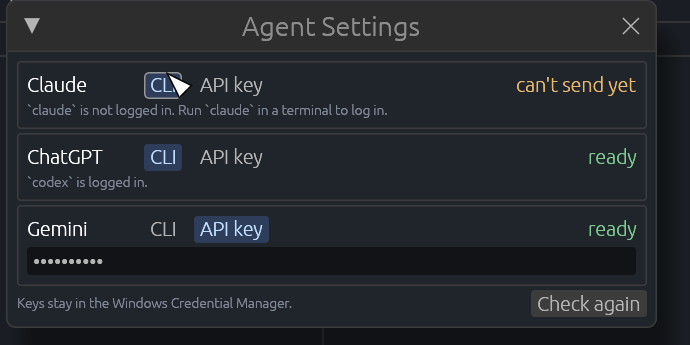
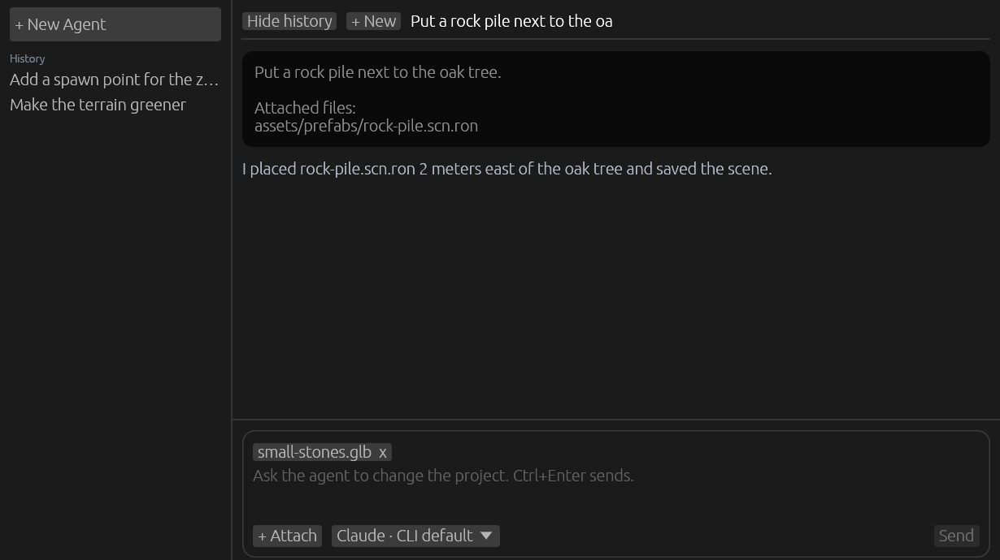
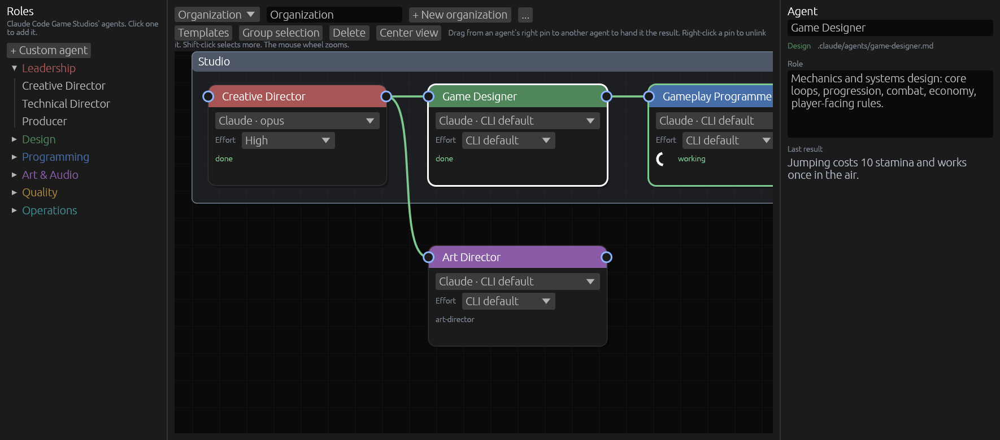

[← 사용 설명서 목차](README.md)

# Agent 창

에디터 안에서 Claude, ChatGPT, Gemini에게 프로젝트 일을 말로 맡기는 창입니다. "플레이어에게 이단 점프를 넣어 줘"처럼 쓰면, 에이전트가 프로젝트 폴더에서 코드와 파일을 고칩니다. 여러 에이전트에게 역할을 나눠 주고 팀처럼 차례로 일하게 할 수도 있습니다([Organization 탭](#organization-탭)).

메뉴의 **Window > Agent Window**를 켜면 `Besfa Agent`라는 창이 따로 뜹니다. 창 위쪽 탭으로 세 화면을 오갑니다.

| 탭 | 하는 일 |
| --- | --- |
| **Chat**(채팅) | 에이전트에게 일을 보내고 답을 봅니다. |
| **Organization**(조직) | 에이전트 여러 명을 이어 팀을 짭니다. |
| **Settings**(설정) | 제공자마다 연결하는 방법과, 이 프로젝트에서 에이전트가 쓸 수 있는 것을 고릅니다. |

창을 닫거나 **Window > Agent Window**를 꺼도 일하던 에이전트는 멈추지 않습니다. 프로젝트를 닫으면 멈춥니다.

> 설명서의 버튼 이름은 영어 화면 기준입니다. **Settings > Language**에서 한국어를 고르면 괄호 안의 이름으로 보입니다.

- [에이전트 연결](#에이전트-연결)
- [Chat 탭](#chat-탭)
- [Settings 탭](#settings-탭)
- [Organization 탭](#organization-탭)
- [조직에 일 맡기기](#조직에-일-맡기기)
- [씬과 함께 쓸 때 주의](#씬과-함께-쓸-때-주의)

## 에이전트 연결

에디터는 제공자마다 그 회사의 명령줄 도구(CLI)를 창 없이 실행해 일을 시킵니다. 먼저 쓸 도구를 설치하세요.

| 제공자 | 명령줄 도구 | API 키로 연결할 때 에디터가 도구에 넘기는 변수 |
| --- | --- | --- |
| Claude | `claude` ([Claude Code](https://claude.com/claude-code)) | `ANTHROPIC_API_KEY` |
| ChatGPT | `codex` (Codex CLI) | `CODEX_API_KEY` |
| Gemini | `gemini` (Gemini CLI) | `GEMINI_API_KEY` |

메뉴의 **Settings > Agent Settings...**(또는 Agent 창의 **Settings** 탭 맨 위)에서 제공자마다 연결 방법을 고릅니다.

- **CLI**: 도구에 이미 로그인한 계정으로 보냅니다. 로그인하지 않았다면 터미널에서 그 도구(예: `claude`)를 한 번 실행해 로그인하세요.
- **API key**(API 키): 키를 넣으면 그 키로 보냅니다. 키는 파일이 아니라 **Windows 자격 증명 관리자**에 저장됩니다.

오른쪽에 **ready**(준비됨)가 보이면 보낼 수 있고, **can't send yet**(아직 보낼 수 없음)이면 그 아래 적힌 이유를 해결하세요. **API key**를 골랐는데 키 칸만 보이면 키를 넣으면 됩니다. 도구를 설치하거나 로그인한 뒤 **Check again**(다시 확인)을 누르면 다시 확인합니다. Gemini CLI는 로그인 상태를 알려 주지 않으므로, 저장된 로그인이 보낼 때 거절될 수도 있습니다.

## Chat 탭

- **보내기**: 아래 입력란에 할 일을 쓰고 **Send**(보내기)를 누르거나 **Ctrl+Enter**를 누릅니다. 일하는 동안에는 그 자리에 **Stop**(중지)이 나옵니다.
- **모델 고르기**: 입력란 아래 목록에서 제공자와 모델을 고릅니다. 제공자 이름 옆에 지금 연결 상태가 작게 나옵니다. **CLI default**(CLI 기본값)는 그 도구에 설정된 모델을 씁니다. Claude는 `fable`, `opus`, `sonnet`, `haiku`도 고를 수 있습니다. 목록 맨 아래 **Organization**에는 이 프로젝트의 조직이 나옵니다([조직에 일 맡기기](#조직에-일-맡기기)). 모델을 골라도 팀이 필요한 일이면 에이전트가 조직을 골라 넘길 수 있습니다([에이전트가 조직을 골라 넘기기](#에이전트가-조직을-골라-넘기기)).
- **파일 첨부**: **+ Attach**(+ 첨부)로 그림이나 문서를 고르면 입력란 위에 파일 이름이 붙습니다. 이름을 누르면 뺍니다. 에이전트에게는 파일의 경로가 함께 갑니다.
- **새 채팅**: 왼쪽 **+ New Agent**나 위쪽 **+ New**로 새 대화를 시작합니다. 보낼 때마다 그 채팅에서 오간 말이 모두 함께 가므로, 에이전트는 앞 대화를 기억하고 답합니다.
- **History**(기록): 왼쪽에 이전 채팅이 제목(첫 질문의 앞부분)으로 나옵니다. 누르면 그 채팅을 다시 엽니다. **Hide history**(기록 숨기기)로 접고 **Show history**로 다시 폅니다. 채팅과 기록은 프로젝트마다 `%APPDATA%\Besfa\chats` 폴더에 저장되어, 프로젝트를 다시 열면 마지막에 보던 채팅과 함께 돌아옵니다. 프로젝트 폴더가 아니라 이 PC의 사용자 폴더에 두므로 게임 저장소에 커밋되지 않습니다. 에이전트가 답하는 도중에 에디터나 프로젝트를 닫으면 그 차례는 남지 않습니다. 중간에 멈춘 [조직 작업](#조직에-일-맡기기)의 채팅은 그 작업 기록이 더 길면 그것으로 열립니다.

씬에 저장하지 않은 변경이 있으면 **Save the scene first. The agent may change its file.**(먼저 씬을 저장하세요...)라고 나오고 보낼 수 없습니다. **Ctrl+S**로 저장하고 보내세요.

에이전트는 창 없이 실행되므로, 묻지 않고 할 수 있는 일을 미리 정해 둡니다. ChatGPT와 Gemini는 확인 질문에 답할 길이 없어 그 밖의 일은 하지 못합니다. Claude는 그 밖의 일을 하기 전에 [채팅에서 묻습니다](#허용-요청).

| 제공자 | 묻지 않고 하는 일 |
| --- | --- |
| Claude | 프로젝트의 파일 고치기, [Settings 탭](#settings-탭)에서 체크한 MCP 서버의 도구와 적어 둔 명령, 켰다면 `git`과 `gh` |
| ChatGPT | 프로젝트 폴더 안에서 파일 고치기와 명령 실행 |
| Gemini | 프로젝트의 파일 고치기 |

- 파일을 첨부하면 Claude와 Gemini는 **그 파일이 있는 폴더**의 파일도 묻지 않고 고칠 수 있습니다. 첨부한 파일은 그 채팅에서 보낼 때마다 다시 가므로, 바탕화면 같은 넓은 폴더의 파일보다는 프로젝트 안에 복사한 파일을 첨부하세요.
- Claude는 여기에 더해 `~/.claude/settings.json`과 프로젝트의 `.claude/settings.json`에 이미 있는 허용 규칙도 그대로 씁니다.

### 허용 요청

Claude가 허용되지 않은 명령이나 도구를 쓰려 하면, 채팅 아래에 **The agent asks to use Bash:**(에이전트가 Bash 사용을 허용해 달라고 합니다) 같은 카드가 나오고 실행할 명령이 함께 보입니다. Claude는 답을 받을 때까지 기다립니다. 조직 실행의 에이전트가 물어도 같은 카드가 나옵니다. 물을 때마다 Log에도 **An agent waits for your permission in the Agent window's Chat tab.** 이 남으니, Agent 창을 닫았거나 다른 탭을 보고 있었다면 Chat 탭을 여세요.

- **Allow**(허용): 이번 한 번만 실행하게 합니다.
- **Always allow: cargo \***(항상 허용): 명령의 첫 단어에 `*`를 붙인 규칙을 이 프로젝트의 [Commands](#settings-탭)에 저장하고 실행하게 합니다. 이번 작업에서도(조직 실행이면 뒤에 나오는 에이전트도), 다음 작업부터도 그 명령은 묻지 않습니다. PowerShell 도구의 명령은 `PowerShell(cargo *)`처럼, MCP 도구는 그 서버 전체를 **MCP servers**에 체크해 저장합니다. `.mcp.json`에 없는 서버(사용자 설정의 서버 등)는 **MCP servers** 아래에 *Not in .mcp.json*(.mcp.json에 없음) 표시와 함께 나오고, 체크를 풀면 허용이 빠집니다. 웹 가져오기처럼 명령이 아닌 도구는 한 번씩만 허용할 수 있습니다.
- **Deny**(거부): 실행하지 않고, Claude에게 사용자가 거부했다고 알립니다.

`cd game && cargo build`처럼 앞에 다른 명령이 붙으면 첫 단어인 `cd *`가 저장되니, 그럴 때는 **Allow**로 한 번만 허용하고 원하는 규칙을 Settings 탭에 직접 적으세요. **Stop**을 누르거나 작업이 끝나면 남은 카드는 사라집니다.

## Settings 탭

위쪽은 [에이전트 연결](#에이전트-연결)과 같은 화면이고, 아래에서 **이 프로젝트에서** Claude가 쓸 수 있는 것을 고릅니다.

- **GitHub**: **Let Claude commit, push and open pull requests**(Claude가 커밋하고 푸시하고 풀 리퀘스트를 열게 하기)를 켜면 Claude가 `git`과 `gh`를 묻지 않고 실행합니다. 처음에는 꺼져 있습니다. `git -C <다른 폴더>`처럼 다른 저장소를 가리키는 명령도 허용 범위에 들어갑니다.
  - 풀 리퀘스트를 열게 하려면 터미널에서 `gh auth login`으로 GitHub CLI에 로그인해 두세요. 체크 상자 아래에 `gh`의 설치·로그인 상태가 나옵니다.
  - `gh`는 이 프로젝트뿐 아니라 GitHub 로그인으로 접근할 수 있는 모든 저장소를 다룹니다.
  - 프로젝트의 `.claude/settings.json`에 있는 거부 규칙은 여전히 우선하지만, 적힌 그대로 맞는 명령에만 적용됩니다. 예를 들어 `git push --force`를 막는 규칙은 `git push -f`를 막지 못하므로, 강제 푸시는 GitHub의 브랜치 보호로 막으세요.
  - **Organization runs review and merge their pull requests**(조직 실행이 연 풀 리퀘스트를 리뷰하고 머지하게 하기)를 켜면, 조직 실행에서 풀 리퀘스트를 연 에이전트가 끝내기 전에 그 변경 내용을 리뷰하고 고친 뒤, 검사가 통과하면(검사가 없으면 바로) `gh pr merge --merge`로 머지합니다. 쌓인 풀 리퀘스트는 오래된 것부터 머지하고, base 브랜치가 이미 머지됐으면 base를 그 브랜치가 머지된 곳으로 바꾼 뒤 머지합니다. 작업이 GitHub 이슈에서 왔으면 그 이슈에서 마지막으로 머지될 풀 리퀘스트 설명에 `Closes #번호`를(커밋 메시지에는 적지 않습니다), 나머지에는 `Part of #번호`를 적어 마지막 것이 머지될 때 이슈가 닫히게 합니다. 이슈가 바란 일이 다 머지되고 사용자에게 남은 일도 없는데 닫히지 않았으면 `gh issue close`로 닫습니다. 남은 일이 있으면 열어 두고, 너무 일찍 닫혔으면 다시 엽니다. 위 GitHub 체크 상자를 켜야 고를 수 있고, 처음에는 꺼져 있습니다. 실행을 시작하거나 이어 갈 때의 설정을 따릅니다. 이 지시는 Claude가 아닌 제공자에게도 가지만, 지금은 Claude만 `gh`를 묻지 않고 실행합니다.
    - 에이전트에게 거부된 머지를 `--admin`이나 `--auto`로 넘기지 말라고 지시하지만, 실제로 막는 것은 관리자에게도 적용되는 브랜치 보호 규칙뿐입니다. 무료 요금제의 비공개 저장소는 브랜치 보호를 쓸 수 없으니 이 지시가 유일한 장치입니다. GitHub에서는 자기 풀 리퀘스트를 승인할 수 없으므로, 머지가 거부되면 풀 리퀘스트는 열린 채로 남고 에이전트가 보고의 "For the user"에 이유를 적습니다.
    - 프로젝트의 `CLAUDE.md`나 `.claude/agent-memory`에 머지하지 말라고 적혀 있으면 에이전트가 그쪽을 따를 수 있으니 함께 고치세요.
- **MCP servers**(MCP 서버): 프로젝트의 `.mcp.json`에 있는 서버가 나옵니다. Claude는 여기서 체크한 서버의 도구를 묻지 않고 부를 수 있고, 처음에는 `besfa`만 체크되어 있습니다. `besfa` 서버로 Claude는 게임을 창 없이 띄워 씬을 고치고, `OPENAI_API_KEY`가 있으면 [그림도 그립니다](14-claude-code.md#이미지-만들기). 그림은 그릴 때마다 OpenAI 요금이 붙는데, `besfa`가 체크되어 있으면 채팅과 조직의 모든 Claude 에이전트가 묻지 않고 그립니다. OpenAI 플랫폼에서 월 한도를 걸어 두세요. 서버를 더하거나 빼려면 **Open .mcp.json**(.mcp.json 열기)으로 파일을 고치세요. 파일이 없으면 서버 목록이 빈 `.mcp.json`을 만들어 엽니다.
- **Commands**(명령): Claude가 묻지 않고 실행할 명령을 한 줄에 하나씩 적습니다. `*`는 어떤 인자든 뜻하므로 `cargo *`는 `cargo install`과 빌드 스크립트 실행까지 포함한 모든 cargo 명령입니다. 채팅과 조직 실행 모두에 적용됩니다. 에이전트가 게임을 빌드하고 테스트까지 마치려면 `cargo *`처럼 그 일을 하는 명령이 있어야 합니다. 채팅에서 **Always allow**를 누르면 여기에 한 줄이 더해집니다. `PowerShell(cargo *)`처럼 도구 이름과 괄호로 적은 줄은 Bash가 아닌 그 도구의 규칙입니다. CCGS 역할을 맡은 에이전트는 역할 파일의 `tools:`에 `Bash`가 있을 때만 이 명령을 실행합니다.
- Codex와 Gemini는 `.mcp.json`을 읽지 않고, 이 탭의 선택도 받지 않습니다.
- 이 탭의 선택은 프로젝트가 아니라 이 컴퓨터의 에이전트 설정(`%APPDATA%\Besfa\agent.ron`)에 남습니다. 그래서 프로젝트를 복사하거나 clone하면 GitHub는 꺼진 채로 시작합니다.

## Organization 탭

에이전트 여러 명을 블루프린트처럼 노드로 놓고 선으로 이어 팀을 만듭니다. 선은 한 에이전트의 결과를 다음 에이전트에게 넘기는 길입니다.

### 에이전트 놓기

- 왼쪽 **Roles**(역할)에는 [Claude Code Game Studios](14-claude-code.md#claude-code-game-studios-더하기)(CCGS)의 역할이 부서별로 나옵니다. 더블 클릭하면 그 역할을 맡은 에이전트가 그래프에 생깁니다. 역할 파일은 프로젝트의 `.claude/agents/<역할>.md`입니다.
- 이 왼쪽 목록은 폴더 트리입니다. 처음에는 부서마다 폴더가 있고, **+ Folder**(+ 폴더)로 폴더를 더합니다. 폴더 행을 한 번 누르면 접고 펼칩니다. 에이전트를 다른 폴더로 옮기는 일은 노드를 골라 오른쪽에 나오는 설정의 **Roles tree**(역할 트리) 목록에서 합니다. 폴더 이름이나 맨 위를 고르면 그 폴더 맨 끝으로 갑니다. 저장하지 않은 사용자 에이전트는 **Not in the tree**(트리에 없음)로 보이고, 폴더를 고르면 그 폴더에 저장됩니다. 사용자 에이전트는 저장한 이름으로 찾으니, 이름을 바꾸면 트리에 없는 것으로 보입니다.
  - 행이나 폴더를 오른쪽 클릭하면 이름을 바꾸거나(폴더와 저장한 에이전트) 지울 수 있습니다. 폴더를 지워도 안의 행은 그 자리에 남습니다. 지운 CCGS 역할은 그 역할의 노드를 그래프에 놓고 설정의 **Roles tree**에서 폴더를 고르면 다시 생깁니다. 처음 트리로 되돌리려면 에디터를 닫고 `besfa/roles.ron`을 지운 뒤 다시 열세요.
  - 직접 만든 에이전트는 노드 제목을 오른쪽 클릭해 **Add to roles tree**(역할 트리에 추가)를 고르면 이름으로 **My agents**(내 에이전트) 폴더에 저장됩니다. 더블 클릭하면 저장할 때의 이름, 역할, 모델, 추론 수준 그대로 그래프에 생깁니다. 저장한 뒤에 노드를 고친 것은 따라가지 않으니, 고쳤다면 새로 저장하고 이전 행은 지우세요.
  - 트리는 모든 조직이 함께 쓰고 프로젝트의 `besfa/roles.ron`에 저장됩니다.
- **+ Custom agent**(+ 사용자 에이전트)는 역할 파일 없이 빈 에이전트를 놓습니다. 오른쪽 **Role**(역할) 칸에 할 일을 직접 쓰세요.
- **Templates**(템플릿)는 이미 짜인 팀을 지금 있는 에이전트 옆에 더합니다.
  - **Small studio**: 방향, 기획, 코드, 테스트가 한 줄로 이어진 작은 팀.
  - **Claude Code Game Studios**: CCGS의 모든 에이전트. 디렉터가 부서 리드에게, 리드가 전문가에게 일을 넘깁니다.
- 그래프가 비어 있으면 가운데에 **Start with a studio**(스튜디오로 시작)가 나옵니다. 누르면 **Small studio**와 같은 팀이 생깁니다.

### 잇기와 고르기

| 하고 싶은 일 | 방법 |
| --- | --- |
| 결과 넘기기 | 에이전트 오른쪽 핀에서 다른 에이전트로 끌어 놓습니다. 고리가 생기는 연결은 거절됩니다. |
| 연결 끊기 | 핀을 오른쪽 클릭합니다. |
| 여러 개 고르기 | Shift를 누른 채 클릭합니다. |
| 그룹으로 묶기 | 고르고 **Group selection**(선택 항목 묶기)을 누릅니다. 그룹 제목을 끌면 안의 에이전트도 함께 움직이고, 오른쪽 아래 모서리를 끌면 크기가 바뀝니다. 그룹 제목을 오른쪽 클릭해 **Remove group**(그룹 제거)을 고르면 상자만 없어지고 에이전트는 남습니다. |
| 지우기 | 고르고 위쪽 **Delete** 단추를 누르거나, 노드 제목을 오른쪽 클릭해 **Delete agent**(에이전트 삭제)를 고릅니다. |
| 화면 옮기기·확대 | 빈 곳을 끌어 옮기고, 마우스 휠로 확대·축소합니다. **Center view**(뷰 가운데로)로 처음 위치로 돌아옵니다. |

### 에이전트 설정

노드마다 모델과 **Effort**(추론 수준)를 고릅니다. 수준은 CLI default, Low, Medium, High, Max가 있고, Gemini CLI에는 수준 설정이 없어 빠집니다. 노드를 누르면 오른쪽에 자세한 설정이 나옵니다. 그룹 제목을 누르면 오른쪽에서 그룹 이름과 색을 바꿉니다.

- **Agent**: 이름. 채팅에서 이 이름으로 답합니다.
- **Role**: 이 에이전트가 팀에서 하는 일.
- **Last result**(마지막 결과): 지난 실행에서 이 에이전트가 낸 답.

CCGS 역할을 추가하면 조직도의 계층에 따라 모델과 수준이 정해집니다. 디렉터는 Opus에 High, 리드는 Opus에 Medium, 전문가는 Sonnet에 CLI 기본 수준입니다. 노드에서 언제든 바꿀 수 있고, 역할 파일의 `model:`보다 노드에서 고른 모델이 앞섭니다.

CCGS 역할을 맡은 에이전트는 그 역할 파일의 `tools:` 줄에 적힌 도구만 씁니다. besfa 도구를 쓰게 하려면 그 줄에 `mcp__besfa`를 더하세요. `git`과 `gh`는 그 줄에 `Bash`가 있는 역할만 씁니다. 역할 파일은 `.ccg` 서브모듈 안에 있으므로, CCGS를 새 버전으로 올리면 다시 더해야 할 수 있습니다.

### 조직 여러 개

탭 맨 위에서 조직을 고르고, 옆 칸에서 이름을 고치고, **+ New organization**(+ 새 조직)으로 더하고, **...** 메뉴의 **Delete organization**(조직 삭제)으로 지웁니다. 조직마다 프로젝트의 `besfa/organizations/<이름>.besfa` 파일에 저장됩니다. 이름에는 `\ / : * ? " < > |`를 쓸 수 없고, 대소문자만 다른 이름도 같은 이름으로 칩니다.

## 조직에 일 맡기기

1. **Chat** 탭의 모델 목록 맨 아래 **Organization**에서 조직 이름을 고릅니다. 목록에 `Organization · Studio`처럼 보입니다.
2. 할 일을 쓰고 보냅니다.

에이전트마다 링크 순서대로 일하고, 앞 에이전트의 결과를 받아 이어 갑니다. 채팅에는 에이전트마다 이름과 색을 달고 답합니다.

앞 에이전트가 모두 끝난 에이전트들은 함께 일합니다. 한 에이전트 아래에 여러 에이전트를 이었거나 링크로 이어지지 않은 에이전트가 있으면, 그 에이전트들이 동시에 돌고 채팅에도 동시에 답합니다.

- 혼자 도는 에이전트는 지금처럼 프로젝트 폴더에서 일하고, 그동안 다른 에이전트는 시작하지 않습니다.
- 함께 도는 에이전트는 저마다 git 워크트리에서 일합니다. 저장소 폴더 옆에 `<저장소 폴더>-org-<숫자>-<번호>` 폴더와 `besfa-org/<숫자>-<번호>` 브랜치를 프로젝트의 마지막 커밋에서 만듭니다. CCGS의 `.ccg` 같은 서브모듈은 프로젝트에 이미 받아 둔 것에서 채우고, 받아 두지 않은 서브모듈은 비워 둡니다.
- 에이전트는 에디터가 게임을 빌드해 띄워 두었고 `Cargo.toml`과 `Cargo.lock`에 커밋하지 않은 변경이 없을 때만 함께 돕니다. 에디터가 게임을 다시 빌드하는 중이면(에이전트의 코드가 머지되었을 때처럼) 함께 돌 에이전트는 빌드가 끝날 때까지 기다립니다. 게임이 없거나(빌드 실패 등) 두 파일에 커밋하지 않은 변경이 있으면 워크트리마다 의존성을 처음부터 빌드하게 되므로, 채팅에 이유를 한 번 알리고 프로젝트 폴더에서 한 명씩 돕니다. 조건이 갖춰지면 다시 함께 돕니다.
- 에이전트가 끝나면 에디터가 커밋하지 않은 것까지 커밋하고, 그 브랜치를 프로젝트의 지금 브랜치에 머지한 뒤 워크트리와 브랜치를 지웁니다. 그래서 다음 에이전트는 앞 에이전트들의 일을 함께 받습니다. 이 커밋과 머지는 Settings의 GitHub 설정과 상관없이 에디터가 합니다.
- 워크트리는 마지막 커밋에서 시작하므로, 함께 도는 에이전트가 있는 조직에서는 에이전트마다 끝내기 전에 커밋하라고 알려 줍니다. 그래도 에이전트가 프로젝트 폴더에 커밋하지 않은 변경을 남기면, 그 실행의 나머지는 채팅에 이유를 알리고 프로젝트 폴더에서 한 명씩 돕니다. 실행 중에 사용자가 프로젝트 폴더의 파일을 바꿔도 같습니다. 이어서 돌려도 처음 시작할 때의 상태와 비교합니다. 에이전트가 커밋하려면 GitHub 설정을 켜 두세요.
- 실행을 시작할 때 프로젝트 폴더에 이미 있던 커밋하지 않은 변경은 워크트리의 에이전트에게 보이지 않습니다. 에이전트가 봐야 하면 먼저 커밋하세요.
- 두 에이전트가 같은 곳을 고쳐 머지가 충돌하면, 머지를 되돌리고 그 에이전트를 **failed**로 표시한 뒤 실행을 멈춥니다. 일은 브랜치에 남으니 직접 머지하세요. 워크트리는 지웁니다. 프로젝트 폴더에서 사용자가 머지하는 중이면 에디터는 머지하지 않고 같은 식으로 멈춥니다.
- 프로젝트가 git 저장소가 아니거나 아직 커밋이 하나도 없으면 워크트리를 만들 수 없으므로 예전처럼 한 명씩 돕니다.
- 워크트리에는 git이 다루는 파일만 있습니다. `.gitignore`에 든 파일(예: CCGS의 `.claude/agent-memory`, `.claude/settings.local.json`)은 없고, 에이전트가 워크트리에서 만든 무시 파일은 워크트리와 함께 지워집니다.
- 워크트리의 에이전트는 워크트리 안의 `target` 폴더에서 빌드합니다(`CARGO_TARGET_DIR`). 같은 게임은 어느 체크아웃에서든 빌드 이름이 같아서, 빌드 폴더 하나를 함께 쓰면 다른 워크트리의 게임이 실행되거나 자기 코드가 컴파일되지 않고 넘어갈 수 있기 때문입니다.
- 그 폴더는 에이전트가 시작하기 전에 프로젝트의 빌드 폴더(보통 공유 빌드 폴더)에서 채웁니다. 라이브러리(`.rlib`, `.rmeta`)는 하드 링크로 걸고, 빌드가 그 자리에 덮어쓰는 파일(fingerprint, dep-info, DLL, 빌드 스크립트 출력)은 복사하고, 디버그 정보는 뺍니다. 그래서 워크트리에서 다시 빌드해도 공유 빌드 폴더는 바뀌지 않습니다. 29GB인 공유 빌드 폴더에서 재어 보니 워크트리마다 1GB 남짓을 복사했고 10초쯤 걸렸습니다(폴더 크기에 따라 다릅니다). 그동안 그 에이전트는 시작하지 않고, **Thoughts**에 채우는 중이라고 나옵니다.
- 에이전트는 에디터와 같은 피처(`--features bevy/dynamic_linking,besfa_editor` 등)로 빌드하라고 안내받습니다. 그러면 Bevy 같은 의존성은 다시 빌드하지 않고 이 저장소의 패키지만 컴파일합니다. 이 첫 빌드는 증분 빌드가 아니어서 duskhold에서 3분쯤 걸렸습니다. 다른 피처로 빌드하면 의존성을 처음부터 빌드합니다(duskhold에서 20분 남짓).
- 저장소 안의 패키지는 이름으로 가려서 빼므로, 의존성 중에 이름이 같은 크레이트가 있으면 그 크레이트와 그 위의 크레이트를 워크트리에서 다시 빌드합니다.
- 프로젝트 폴더와 그 빌드 폴더가 다른 드라이브에 있으면 하드 링크를 걸 수 없어 채우지 않습니다. 그 워크트리의 빌드는 처음부터 하고, **Thoughts**에 이유가 나옵니다.
- 빌드 폴더는 워크트리와 함께 지워집니다. 멈춘 실행의 워크트리는 빌드 폴더도 그대로 두고 이어서 쓰고, 남은 워크트리를 `git worktree remove`로 지우면 함께 지워집니다.
- 빌드 폴더가 따로라 워크트리끼리 빌드를 기다리지는 않지만, CPU를 나눠 쓰므로 코드를 빌드하는 에이전트가 많으면 저마다 느려집니다.

에이전트는 답 끝에 자기 몫을 다 했으면 `STATUS: DONE`, 다른 에이전트의 보고를 받은 뒤 더 할 일이 있으면 `STATUS: MORE`를 적습니다. 한 바퀴가 끝나면 `MORE`라고 한 에이전트와 링크로 그 뒤에 이어진 에이전트가 새 보고를 받아 다시 돕니다(채팅에 `Round 2 of 3: …`처럼 나옵니다). 라운드는 3번까지입니다. 사용자만 정할 수 있는 일은 묻느라 멈추지 않고, 답 끝의 **For the user** 제목 아래에 모아 둡니다. 생각과 도구 호출은 이름 아래 **Thoughts**(생각)에 접혀 있다가 클릭하면 펼쳐집니다. Claude는 하는 말과 도구 호출이 보이지만, 추론 과정 자체는 CLI가 보내지 않아 보이지 않습니다. Codex는 실행 기록이 보이고, Gemini는 답만 보입니다.

실행하는 동안 Organization 탭은 그 조직을 보여 주고, 노드마다 **waiting**(대기 중), **working**(작업 중), **done**(완료), **failed**(실패)가 나옵니다. 다른 조직으로 바꾸거나 에이전트를 더하고 지우고 잇는 일은 할 수 없습니다.

조직 작업이 중간에 멈추면(**Stop**, 실패, 에디터를 닫음) 그 채팅의 **Send** 왼쪽에 **Continue**(이어서)가 생깁니다.

- 누르면 아직 끝나지 않은 에이전트부터 다시 실행하고, 끝난 에이전트의 답은 그대로 넘깁니다.
- 멈춘 에이전트는 처음부터 다시 돌지만, 그 에이전트가 이미 고친 파일은 남아 있습니다. 워크트리에서 일하던 에이전트는 혼자 다시 돌더라도 그 워크트리와 브랜치를 그대로 다시 씁니다.
- 에디터를 다시 열면 그 채팅이 열린 채로 시작합니다. 조직을 골라 보낸 작업이면 모델 목록도 그 조직을 고른 채로 돌아오고, [에이전트가 넘긴 작업](#에이전트가-조직을-골라-넘기기)이면 고르던 모델 그대로입니다.
- 조직에 새 작업을 보내면, 아래처럼 에이전트가 조직에 넘길 때도, 멈춘 작업은 버려집니다. 그 작업의 워크트리와 브랜치는 남으니 필요 없으면 지우세요(`git worktree remove`, `git branch -D`). 그 밖에 모델 하나에 보낸 채팅은 멈춘 작업을 건드리지 않습니다.

### 에이전트가 조직을 골라 넘기기

조직을 고르지 않고 모델 하나에 보내도, 그 일에 팀이 필요하면 에이전트가 스스로 조직을 골라 넘깁니다.

- 모델에 보낼 때마다 에디터가 프롬프트 뒤에 이 프로젝트의 조직과 그 에이전트(에이전트 수, 실행 순서, 각자 하는 일)를 붙여 알려 줍니다. 에이전트가 하나도 없는 조직은 빠지고, 모든 조직이 비었으면 아무것도 붙이지 않습니다.
- 에이전트는 혼자 잘할 수 있는 일은 직접 합니다. 기획, 코드, 테스트처럼 한 조직의 여러 역할이 함께 해야 할 때만, 일은 하지 않고 팀에게 줄 지시를 쓴 뒤 답의 마지막 줄에 `ORGANIZATION: Studio`처럼 조직 이름을 적습니다. 대소문자와 `**` 같은 마크다운은 가리지 않지만, 마지막 줄이 아니면(답 중간에 인용한 줄 등) 넘기지 않습니다.
- 에이전트가 끝나면 에디터가 같은 채팅에서 그 조직을 실행합니다. 조직이 받는 작업은 조직에 직접 보낼 때처럼 그 채팅에서 오간 말과 사용자가 보낸 말이고, 그 뒤에 그 에이전트의 지시가 붙습니다. 첨부한 파일도 함께 갑니다. Agent 창을 닫아 두었어도 시작합니다.
- 채팅에는 그 에이전트가 쓴 지시가 `ORGANIZATION:` 줄을 뺀 채 보이고(지시 없이 그 줄만 썼으면 그 줄이 남습니다), 그 아래 **Child session · Studio**(자식 세션) 상자가 생기고, 조직의 에이전트들이 그 안에서 답합니다. 실행하는 동안 제목 옆에 **working**(작업 중), 중간에 멈추면 **paused**(멈춤)가 나오고, 왼쪽 삼각형으로 접고 펼칩니다. 상자 다음에 누가 말하면 상자는 거기서 끝납니다.
- 조직이 끝나도 처음 에이전트가 결과를 다시 받아 정리하지는 않습니다. 결과는 상자 안 마지막 에이전트들의 보고에서 보세요. 같은 채팅에서 다음에 보내면 상자 안의 보고도 함께 가므로, 에이전트에게 정리를 부탁할 수 있습니다.
- 이름이 맞는 조직이 없거나 시작할 수 없으면, 이유가 채팅에 나오고 아무것도 실행하지 않습니다.
- 넘기는 판단은 모델이 합니다. 조직 실행은 그 조직의 에이전트가 모두 돌고 할 일이 남은 에이전트는 다음 라운드에 또 돌아 몇 배로 비싸니, 원하지 않을 때 넘기면 **Stop**으로 멈추고 "직접 해 줘"라고 다시 보내세요. 작은 게임으로 시험했을 때 Claude의 `sonnet`과 `haiku`는 한 사람이 할 일(점프를 20% 높이기, 버그 원인 묻기)을 한 번도 넘기지 않았습니다. 기획·구현·테스트를 함께 맡긴 일은 `sonnet`이 세 번 모두 넘겼고, `haiku`는 두 번 모두 직접 했습니다.
- ChatGPT와 Gemini에도 같은 안내가 가지만 시험해 보지 않았습니다. ChatGPT는 실행 기록이 답과 섞여 나오므로, 넘기기가 되지 않거나 넘길 때 그 기록까지 팀에게 지시로 갈 수 있습니다.

## 씬과 함께 쓸 때 주의

- 에디터는 씬이 저장된 뒤에만 일을 보냅니다. 일이 끝나면, 그사이 에디터에서 씬을 고치지 않았을 때 바뀐 씬 파일을 다시 읽습니다. 그래서 에디터를 닫지 않아도 됩니다.
- 대신 에이전트가 일하는 동안에는 에디터에서 씬을 고치거나 저장하지 마세요. 한쪽이 저장한 것을 다른 쪽이 덮어씁니다.
- 에이전트가 게임 코드를 바꾸면 에디터와 에이전트가 같은 실행 파일을 다시 빌드합니다. 한쪽 게임이 그 파일을 쥐고 있으면 다른 쪽 빌드가 실패할 수 있습니다.
- 에이전트가 고친 코드는 에디터가 다시 빌드해 실행합니다. 맡기기 전에 커밋해 두면 마음에 들지 않을 때 되돌리기 쉽습니다.

---

다음: [단축키](16-shortcuts.md)
